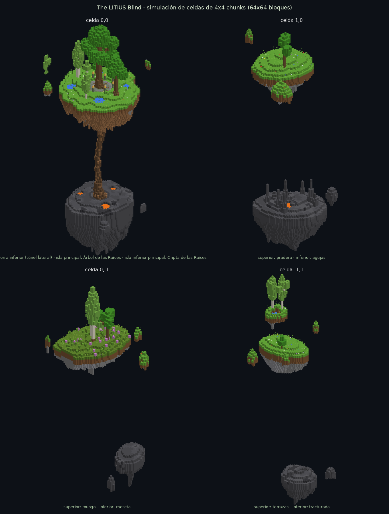
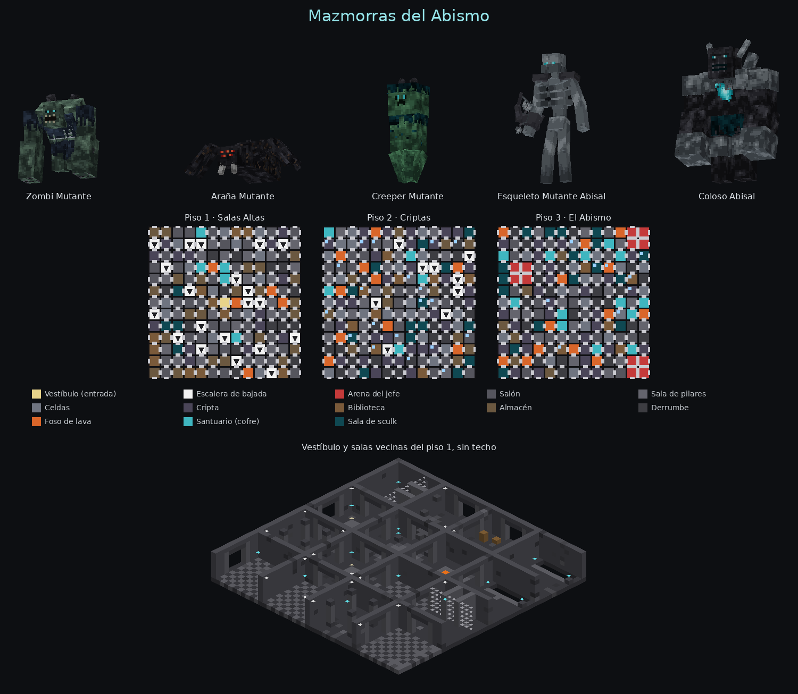
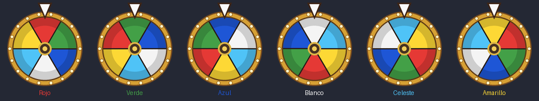
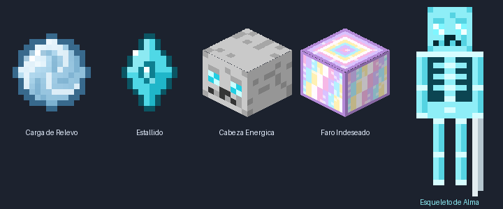
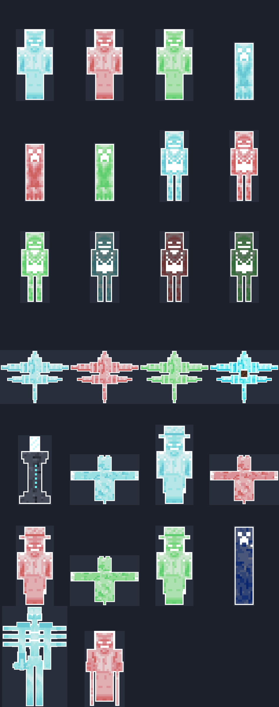
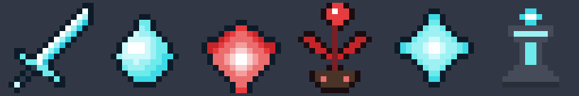

# Addons de mobs para Minecraft Bedrock

| Addon | Descarga | Generador |
|---|---|---|
| **The Revamp of the Soul** (antes Soul Corrupted Mobs; base de Euforia) | [`dist/TheRevampOfTheSoul.mcaddon`](dist/TheRevampOfTheSoul.mcaddon) | `tools/soul_mobs.py` |
| **Medieval Mobs** – mobs medievales | [`dist/MedievalMobs.mcaddon`](dist/MedievalMobs.mcaddon) | `tools/generate.py` |
| **Ruleta de Colores** – ruleta en el HUD con comandos de administrador | [`dist/Roulette.mcaddon`](dist/Roulette.mcaddon) | `tools/roulette.py` |
| **Objetos de Ayuda** – 4 objetos especiales que ayudan al jugador | [`dist/HelperItems.mcaddon`](dist/HelperItems.mcaddon) | `tools/helper_items.py` |
| **The LITIUS Blind** – nueva dimensión de islas flotantes | [`dist/LitiusBlind.mcaddon`](dist/LitiusBlind.mcaddon) | `tools/litius_blind.py` |
| **Mazmorras del Abismo** – dimensión entera de mazmorras con mutantes | [`dist/Abismo.mcaddon`](dist/Abismo.mcaddon) | `tools/abismo.py` |

Abre el `.mcaddon` y activa el pack *Behavior* en el mundo; el de recursos se añade solo. No hace falta activar experimentos
(salvo en The LITIUS Blind y Mazmorras del Abismo, ver abajo).

- The Revamp of the Soul requiere Minecraft Bedrock **1.26.0** o superior.
- Medieval Mobs requiere **1.21.0** o superior.
- Ruleta de Colores y Objetos de Ayuda requieren **1.21.90** o superior.
- The LITIUS Blind y Mazmorras del Abismo requieren **26.20** o superior y el experimento **Beta APIs**.

Los mobs nuevos siguen la guía de estilo [`docs/estilo_texturas.md`](docs/estilo_texturas.md).

---

# The LITIUS Blind



Una nueva dimensión de **islas flotantes sobre el vacío**, en dos capas.

**Cómo activarlo:** en los ajustes del mundo, *Experimentos → Beta APIs* activado, y el pack *Behavior* activo.
Las dimensiones nuevas en Bedrock solo se pueden crear con la *Custom Dimension API*, que de momento es beta
(Minecraft **26.20** o superior). Sin ese experimento el addon no carga.

**Cómo entrar:** con la **Llave de Raíces** (`litius:llave_de_raices`). Por ahora **no se puede craftear ni
conseguir** de ninguna forma: no está en el inventario creativo ni en ningún cofre. Solo con
`/give @s litius:llave_de_raices`. Al usarla te lleva a la isla principal; usada dentro de la dimensión te devuelve
al sitio desde el que entraste. Cooldown 3 s.

| | Islas superiores | Islas inferiores |
|---|---|---|
| Altura | capa **80 hacia arriba** | capas **20 a 50** |
| Bloques | césped o musgo arriba, tierra, y piedra/andesita debajo; **rara vez minerales** | solo bloques de deepslate: deepslate, pizarra empedrada, pulida, baldosas, ladrillos, cincelada y menas de deepslate (raras) |
| Agua / lava | oasis, ríos y lagunas | solo **lagos de lava** |
| Árboles | robles majestuosos (tronco 2x2, raíces y ramas), robles elaborados, abedules majestuosos y abedules gigantes | – |
| Mazmorras | 12 % de las islas, entrada por una **escalera que baja** desde la superficie | 55 % de las islas (más frecuentes), entrada por un **túnel lateral** o una escalera |

- **Tamaño:** las islas miden entre ~20 y ~45 bloques de ancho, un 35 % más pequeñas que las islas del End,
  con huecos de aproximadamente 10–40 bloques entre ellas (ni muy juntas ni muy lejos). Debajo tienen forma de gota,
  con colgajos de piedra.
- **Variedad:** islas superiores de pradera, bosque, musgo (con azaleas), oasis, río, lagunas, colinas
  (rocas al aire), archipiélago, anillo (con agujero en medio) y terrazas (una isla flotando sobre otra), más
  islotes alrededor. Islas inferiores de meseta, agujas, cráter (gran lago de lava), fracturada (partida por una
  grieta), escalones y archipiélago.
- **Isla principal:** más grande (60 bloques), con una plaza de ladrillos de piedra y musgo, farolas, cuatro
  estanques y el **Árbol de las Raíces**, un roble gigante con tronco 3x3 cuyas **raíces caen por el vacío** hasta
  la isla inferior principal (la *Cripta de las Raíces*, con su mazmorra). Debajo de la isla cuelgan raíces.
- **Mazmorras sin mobs:** sala de piedra musgosa (arriba) o de ladrillos de deepslate (abajo), con 1–2 cofres de
  botín, telarañas, farolillos y un altar vacío donde estaría el generador. No hay generadores de mobs.
- **Sin mobs:** por ahora no puede aparecer ningún mob en la dimensión (tampoco con huevos); se eliminan al aparecer.
- **Simulación por celdas de 4x4 chunks:** la dimensión se genera en celdas de 4x4 chunks (64x64 bloques); cada
  celda tiene un grupo de islas superiores y casi siempre uno inferior. Se generan las 5x5 celdas alrededor de cada
  jugador, la más cercana primero, cargándolas con una zona de carga temporal. La imagen de arriba es la simulación
  de cuatro celdas hecha con el mismo generador (`python3 tools/litius_blind.py --preview`, necesita `node`).
- La forma de las islas depende de una semilla propia que se guarda en el mundo la primera vez.
- Debajo de las islas solo hay vacío: cuidado al saltar entre ellas.
- El generador está en `tools/litius_blind/gen.js` y se copia tal cual al pack; `CONFIG` en `tools/litius_blind.py`
  cambia el radio de generación.

---

# Mazmorras del Abismo



Una dimensión que es **una sola mazmorra sin fin**, de **3 pisos** de **salas de 10x10**, hecha casi entera de
bloques de pizarra profunda (ladrillos, baldosas, pulida, cincelada, empedrada y reforzada en techo y suelo).

**Cómo activarlo:** en los ajustes del mundo, *Experimentos → Beta APIs* activado, y el pack *Behavior* activo
(Minecraft **26.20** o superior). Usa la misma *Custom Dimension API* que The LITIUS Blind.

**Cómo entrar:** con la **Llave del Abismo** (`abismo:llave_del_abismo`), que se craftea así:

| | | |
|---|---|---|
| Ladrillos de pizarra profunda | Hueso | Ladrillos de pizarra profunda |
| Hueso | Ojo de ender | Hueso |
| Ladrillos de pizarra profunda | Hueso | Ladrillos de pizarra profunda |

Al usarla apareces en el **vestíbulo** del piso 1 (sin monstruos); usada dentro te devuelve al sitio desde el que
entraste. Cooldown 3 s.

- **Pisos:** Piso 1 · Salas Altas (y 72), Piso 2 · Criptas (y 64) y Piso 3 · El Abismo (y 56). Se baja por
  **escaleras** (≈ 7 % de las salas) y al cambiar de piso sale su nombre en la barra de acción.
- **Salas:** salón, pilares, celdas con barrotes, cripta con sarcófagos y velas, biblioteca, almacén con barriles,
  derrumbe, foso de lava, santuario (siempre con cofre) y salas de sculk (más abundantes abajo). Las puertas son de
  4x4 con marco de pizarra pulida; desde la entrada se llega a casi todas las salas (97 % en las pruebas).
- **Cofres:** en santuarios, celdas, criptas y almacenes. Cuanto más abajo, mejor botín (diamantes, fragmentos de
  eco, chatarra de netherita, manzana dorada encantada…).
- **Monstruos:** puede salir **cualquier mob hostil**, pero **cuanto más fuerte, más raro**:
  peso = 100 · fuerza^(−1,4 + 0,3 · piso). Cada piso de bajada hace los fuertes un poco más frecuentes. Los mobs
  aparecen en salas a 1–3 salas del jugador (nunca en la suya, ni en el vestíbulo ni en las arenas), hasta 6/8/10
  cerca de ti según el piso. Cualquier otro mob que aparezca solo en la dimensión se elimina (los huevos sí
  funcionan).
- **Jefes:** no siguen la regla de rareza. En el piso 3 hay **arenas** (2x2 salas, una cada ~88 salas) donde
  siempre espera el **Coloso Abisal**; al vencerlo deja un cofre con el tesoro junto al pilar central y esa arena
  queda libre. El Wither, el dragón y el guardián anciano no aparecen.

| Mutante | Vida | Ataque | Habilidad |
|---|---|---|---|
| Zombi Mutante | 110 | 11 | Golpe al suelo: 9 de daño y empujón a 5 bloques |
| Araña Mutante | 70 | 7 + veneno 5 s | Salta hacia ti desde 4–12 bloques; trepa |
| Creeper Mutante | 80 | 6 | Se hincha y explota (potencia 3,5) **sin morir** ni romper bloques |
| Esqueleto Mutante Abisal | 90 | ráfagas de 3 flechas | Dispara a 18 bloques |
| **Coloso Abisal** (jefe) | 600 | 16 | Golpe al suelo (14), rugido (oscuridad + lentitud II) e invoca esbirros; barra de jefe |

El Esqueleto Mutante Abisal usa el modelo y las animaciones del esqueleto mutante que pasaste, con una textura nueva
de hueso de pizarra y sculk; los otros cuatro son modelos nuevos. Todos están pintados con la guía de estilo
[`docs/estilo_texturas.md`](docs/estilo_texturas.md).

Probabilidad de cada mob cuando aparece uno:

| Mob | Fuerza | Piso 1 | Piso 2 | Piso 3 |
|---|---|---|---|---|
| silverfish | 0.8 | 13.9 % | 11.3 % | 8.9 % |
| zombie | 1 | 10.2 % | 8.8 % | 7.4 % |
| zombie_villager_v2 | 1.1 | 8.9 % | 8.0 % | 6.9 % |
| husk | 1.2 | 7.9 % | 7.2 % | 6.4 % |
| spider | 1.2 | 7.9 % | 7.2 % | 6.4 % |
| skeleton | 1.3 | 7.1 % | 6.6 % | 6.0 % |
| drowned | 1.5 | 5.8 % | 5.7 % | 5.4 % |
| cave_spider | 1.5 | 5.8 % | 5.7 % | 5.4 % |
| stray | 1.6 | 5.3 % | 5.3 % | 5.1 % |
| slime | 1.8 | 4.5 % | 4.6 % | 4.6 % |
| creeper | 2.2 | 3.4 % | 3.7 % | 3.9 % |
| bogged | 2.2 | 3.4 % | 3.7 % | 3.9 % |
| pillager | 2.8 | 2.4 % | 2.9 % | 3.3 % |
| witch | 3 | 2.2 % | 2.6 % | 3.1 % |
| magma_cube | 3 | 2.2 % | 2.6 % | 3.1 % |
| vindicator | 4 | 1.5 % | 1.9 % | 2.4 % |
| blaze | 4 | 1.5 % | 1.9 % | 2.4 % |
| wither_skeleton | 5 | 1.1 % | 1.5 % | 2.0 % |
| breeze | 5.5 | 0.9 % | 1.4 % | 1.9 % |
| zoglin | 6 | 0.8 % | 1.2 % | 1.8 % |
| piglin_brute | 6.5 | 0.7 % | 1.1 % | 1.7 % |
| evoker | 7.5 | 0.6 % | 1.0 % | 1.5 % |
| Araña Mutante | 8 | 0.6 % | 0.9 % | 1.4 % |
| ravager | 9 | 0.5 % | 0.8 % | 1.3 % |
| Zombi Mutante | 10 | 0.4 % | 0.7 % | 1.2 % |
| Esqueleto Mutante Abisal | 11 | 0.4 % | 0.6 % | 1.1 % |
| Creeper Mutante | 12 | 0.3 % | 0.6 % | 1.0 % |
| warden | 22 | 0.1 % | 0.3 % | 0.6 % |

- La dimensión se genera por regiones de 8x8 salas (los tres pisos) alrededor de cada jugador.
- La rareza (`RARITY`, `DEPTH`), la lista de mobs (`MOBS`) y los números de los mutantes (`MUTANTS`) se cambian en
  `tools/abismo.py`; las salas, en `tools/abismo/gen.js`.

---

# Ruleta de Colores



Comandos para el administrador (operador) del mundo. La ruleta aparece en la **esquina inferior derecha**
de la pantalla de los jugadores y gira hasta caer en el color que elijas.
Tiene 6 colores: **rojo, verde, azul, blanco, celeste y amarillo**.

| Comando | Qué hace |
|---|---|
| `/roulette:show` | Muestra la ruleta. |
| `/spin_roulette:rojo` | Gira la ruleta y la hace caer en rojo. Si estaba oculta, la muestra. |
| `/spin_roulette:verde`, `:azul`, `:blanco`, `:celeste`, `:amarillo` | Igual, con los otros colores. |
| `/spin_roulette:aleatorio` | Gira la ruleta y cae en un color al azar. |
| `/roulette:hide` | Oculta la ruleta. |

- Todos aceptan un selector de jugadores al final, por ejemplo `/spin_roulette:azul @a[tag=juego]`.
  Sin selector se aplican a todos los jugadores.
- Los mismos comandos funcionan con `/scriptevent` (por ejemplo en bloques de comandos):
  `/scriptevent spin_roulette:rojo`, `/scriptevent roulette:show` y `/scriptevent roulette:hide`.
- El giro dura 6 segundos: da varias vueltas, frena poco a poco y suena un clic en cada color.
  Al parar, el color sale en la barra de acción y en el chat.
- El resultado se guarda en el marcador `ruleta`, jugador `resultado`
  (1 rojo, 2 verde, 3 azul, 4 blanco, 5 celeste, 6 amarillo).
- Si un jugador sale y vuelve a entrar con la ruleta abierta, la vuelve a ver.
- La ruleta se dibuja con JSON UI usando títulos ocultos que empiezan por `_roul:`; el resto de títulos se ve normal.
  El tamaño, la esquina y la duración del giro se cambian en `tools/roulette.py` (`UI_SIZE`, `ANCHOR`, `SPIN_TICKS`).

---

# Objetos de Ayuda



Cuatro objetos especiales. Están en el inventario creativo o con `/give @s <id>`.

| Objeto | ID | Qué hace |
|---|---|---|
| Carga de Relevo | `ayuda:carga_de_relevo` | Te impulsa unos **15 bloques hacia arriba** y te da **Caída lenta 15 s** (empieza al llegar arriba). **70 usos** (se gasta uno por uso), **cooldown 30 s**, no se apila. Icono 2D: una bola de viento esférica. |
| Estallido | `ayuda:estallido` | Te cuesta **3 corazones** (primero se gastan los dorados si tienes Absorción) y provoca una explosión que **no rompe bloques ni te daña**. Cada mob a **3 bloques** o menos recibe 3 corazones de daño, sale empujado unos **4 bloques** y recibe **Lentitud II 5 s**. **Cooldown 45 s**, no se apila. 2D en el inventario y **3D en la mano** (rombo celeste que gira). Sin Absorción y con 3 corazones o menos no se puede usar, para no matarte. |
| Cabeza de Esqueleto Enérgica | `ayuda:cabeza_esqueleto_energica` | Cabeza de esqueleto con **ojos celestes**, 3D en el inventario y en la mano. Al usarla aparece un **Esqueleto de Alma** aliado. **Cooldown 45 s**; no se gasta. |
| Faro Indeseado | `ayuda:faro_indeseado` | Bloque brillante tipo ranaluz (nacarado), 3D en el inventario y en la mano. Al usarlo te da un **efecto positivo aleatorio, nivel II, durante 24 s**. Nunca da efectos instantáneos (salud instantánea, saturación). Se gasta al usarlo. |

- La cabeza y el faro son bloques (por eso se ven en 3D): **úsalos apuntando a un bloque** como si los colocaras, o al aire.
  No se quedan colocados; colocarlos cuenta como usarlos.
- Los cooldowns se reinician si sales y vuelves a entrar al mundo.

### Esqueleto de Alma (`ayuda:esqueleto_de_alma`)

- Textura de esqueleto vanilla (64x32, píxeles de 16x16) en **celeste fuego de almas**, con una espada.
- **80 de vida** (4 esqueletos), velocidad **0,253** (un 10 % más que el zombi) y **6 de daño** (3 corazones sin armadura).
- Es tuyo: te sigue, ataca a los monstruos cercanos (menos creepers), a quien te ataca y a quien atacas. No le hace daño la caída ni el fuego.
- Animaciones:
  - **Aparecer**: sale del suelo arrastrándose (0,5 s).
  - **Caminar**: lleva la espada con las dos manos y se inclina hacia delante.
  - **Atacar**: echa la espada atrás y da una estocada hacia delante.
  - **Morir**: se encoge hasta desaparecer.
- Los valores (vida, daño, radio, empuje, duraciones...) están en `CONFIG` y `SKELETON_STATS` al principio de `tools/helper_items.py`.

---

# The Revamp of the Soul





La base es el addon original *Soul Corrupted Mobs v1.0.0*: sus texturas, el **outline blanco**,
las animaciones vanilla y los identificadores `eu_sc:`. Se guarda sin cambios en `sources/soul_corrupted_mobs_v1.0.0/`.
El generador `tools/soul_mobs.py` (con `tools/soul_bosses.py`) lo copia y le añade todo lo demás.

| Mob | IDs |
|---|---|
| Zombi de Alma Corrupta | `eu_sc:soul_corrupted_zombie` (azul, original) / `_red` / `_green` |
| Creeper de Alma Corrupta | `eu_sc:soul_corrupted_creeper` / `_red` / `_green` |
| Esqueleto de Alma Corrupta | `eu_sc:soul_corrupted_skeleton` / `_red` / `_green` |
| Phantom de Alma Corrupta (4 alas puntiagudas, 2,5 veces más grande) | `eu_sc:soul_corrupted_phantom` / `_red` / `_green` |
| Phantom de Alma Domable (montable) | `eu_sc:soul_corrupted_phantom_mount` |
| Esqueleto Wither de Alma Corrupta | `eu_sc:soul_corrupted_wither_skeleton` / `_red` / `_green` |
| Araña de Alma Corrupta (1,3 veces más grande, aspecto monstruoso) | `eu_sc:soul_corrupted_spider` / `_red` / `_green` |
| Zombi Invocador de Alma Corrupta (sombrero de granjero y capa) | `eu_sc:soul_corrupted_summoner` / `_red` / `_green` |
| **Sub-jefe**: Creeper Titán de Alma Corrupta (azul marino) | `eu_sc:soul_corrupted_creeper_titan` |
| Esqueleto Encapotado (variante vanilla, sin alma) | `eu_sc:caped_skeleton` |
| **Mini jefe**: Esqueleto Mutante de Alma Corrupta | `eu_sc:soul_mutant_skeleton` |
| **Mini jefe**: Zombi Cuchilla de Alma Corrupta | `eu_sc:soul_blade_zombie` |
| Altar de Curación | `eu_sc:healing_altar` |

### Progresión

1. Los mobs de alma sueltan **Esencia de Alma**: un 9 % de probabilidad, más con Botín. Todos los drops son un 75 % menos frecuentes.
2. **Planta de Alma Corrupta**: 4 esencias, hongo carmesí y tierra de almas. Úsala para invocar al **Zombi Cuchilla**.
3. El Zombi Cuchilla suelta el **Núcleo de Alma**.
4. **Estrella de Alma Corrupta**: 7 esencias, el núcleo y un diamante. Úsala para invocar al **Esqueleto Mutante**.
5. El Esqueleto Mutante suelta la **Espada de Alma Corrupta** (siempre).

### Mini jefes (sin barra de vida)

**Esqueleto Mutante (azul):**
- Usa el modelo de Mutant Creatures: modelo, textura recoloreada y animaciones, guardados en `sources/mutant_skeleton/`.
- Mide el doble que un jugador y tiene 400 de vida.
- Su espada mide unos 2,4 bloques: hoja ancha con filos blancos, guarda con puntas y pomo.
- Ataca con una espada gigante y hace un **slash épico**.
- De vez en cuando lanza una **explosión** que no rompe bloques: te empuja y te deja **ciego 3 s**.
- **Entrada**: cae del cielo, aterriza agachado y se levanta.
- **Muerte**: se arrodilla y se desploma. Después invoca un creeper y un zombi de alma.

**Zombi Cuchilla (rojo):**
- Tamaño de jugador, con cuchillas en vez de brazos.
- 400 de vida y velocidad 0,33.
- Su ataque normal es exagerado: echa las cuchillas atrás y se lanza con ellas hacia delante.
- **Explosión**: lentitud II 3 s.
- **Embestida**: si te alcanza, lentitud 255 durante 1 s.
- **Invoca zombis rojos** (máximo 4 cerca).
- **Entrada**: sale del suelo.
- **Muerte**: algo lo arrastra bajo tierra mientras se resiste.

### Nuevos mobs

**Araña de Alma Corrupta:**
- Ocho ojos blancos, colmillos, abdomen con púas y patas con garras.
- Trepa paredes y salta sobre el jugador.

**Zombi Invocador:**
- Cuando te ve invoca un zombi y un esqueleto de su mismo color: levanta los brazos y salen del suelo.
- Lo repite cada 30 s, y nunca si ya hay muchos mobs de alma cerca.

**Creeper Titán (sub-jefe):**
- Solo existe en azul marino, con outline. Más alto que un creeper y con patas largas: unos 2,25 bloques.
- Al aparecer provoca una mini explosión que no rompe bloques.
- Al explotar deja un creeper de alma celeste normal.
- Aparece rara vez, en el Overworld y en el Nether.

**Esqueleto Encapotado:**
- Un esqueleto vanilla, con su textura normal, que lleva capa y capucha.
- Dispara 2 flechas seguidas.

### Esqueleto Wither de Alma Corrupta

- Hay uno en cada color, más oscuro y con el tamaño normal de un wither skeleton (1,2 veces un esqueleto).
- Corre a 0,4 (el wither skeleton normal va a 0,25), con una carrera exagerada: inclinado y con los brazos hacia atrás.
- Su **slash** hace 60 de daño: mata de un golpe aunque lleves armadura de hierro completa.
- **Muere de un golpe** (1 de vida) y no suelta nada.

### Resto

- **Colores**: más suaves y apagados que antes, con el outline blanco. El altar y el phantom domable conservan sus colores.
- **Inclinación al ir hacia el objetivo**: el zombi se inclina un poco más que el creeper y el esqueleto, menos que los dos.

- **Al golpear**: Oscuridad, más un extra según el color:
  - azul: lentitud.
  - rojo: prende fuego.
  - verde: veneno.
- Las flechas de los esqueletos invocan rayos, en los tres colores.
- **Inmunes** a fuego, lava, magma, congelación, ahogamiento y wither. No se convierten en ahogados ni en *strays*.
- Caminan un 12 % más rápido que sus versiones vanilla.
- **Spawn natural**: los mobs de alma son aproximadamente **el 35 %** de los monstruos que aparecen en sus biomas. Las probabilidades de cada bioma se calculan a partir de cuánto aparecen ahí los mobs vanilla.
  - Azules: solo en el Nether (valle de arena de almas, bosque distorsionado y deltas de basalto).
  - Rojos: solo en el Nether (bosque carmesí y desiertos del Nether).
  - Verdes: solo en el Overworld, en cualquier bioma salvo sabanas y biomas fríos.
  - Phantoms: el 35 % de los phantoms vanilla (los del insomnio) se convierte en phantoms de alma verdes.
- **Oscuridad**: dura 2 segundos.
- **Phantoms**:
  - todos vuelan 1,65 veces más rápido;
  - el hostil detecta jugadores a 96 bloques, ataca cada 2-5 s y vuela a 6-12 bloques sobre ti;
  - el domable se domestica con huesos y se monta como el happy ghast, a 0,033 de velocidad (happy ghast: 0,016).
- **Altar de Curación**:
  - mide 2 bloques, es inmune a todo daño y siempre mira hacia el mismo lado;
  - a **12 bloques** o menos te lanza un rayo de partículas y te cura 1 de vida por segundo;
  - se recoge agachado + interactuar;
  - receta: `C F C / C M C / C C C` (C = pizarra profunda rocosa, F = farol de almas, M = manzana dorada).
- **Espada**: 9 de daño, Wither II + quemadura, daño en área, y lleva el tag `minecraft:is_sword`.

---

# Medieval Mobs

12 mobs **nuevos e independientes** (no reemplazan a los vanilla) inspirados en los
zombis, esqueletos, slimes, endermen y creepers, con aspecto medieval, modelos
propios y golpes que dejan **efectos negativos**.


## Los mobs

Cada mob tiene su propio identificador, su huevo de generación, sus reglas de spawn y su botín.
Los efectos de la columna "Al golpear" se aplican en cada golpe, flecha o explosión.

| Mob | ID | Qué hace | Al golpear |
|---|---|---|---|
| Caballero Zombi Caído | `medieval:zombie_knight` | Yelmo con visor y cresta, armadura completa, tabardo con cruz y espada de hierro. Resiste el empuje | Lentitud II, Debilidad |
| Zombi Lanzaflechas | `medieval:zombie_archer` | **Lanza flechas a puñetazos**, en ráfagas de dos con sus guanteletes gigantes. Lleva carcaj y gorro con pluma | Veneno, Hambre |
| Zombi de la Peste | `medieval:zombie_plague` | Médico de la peste: máscara de pico, sombrero, túnica larga e incensario | Náusea, Veneno, Hambre II |
| Esqueleto Espadachín | `medieval:skeleton_swordsman` | **Cuerpo a cuerpo** con espada, escudo en el brazo, gambesón y casco de hierro | Debilidad, Lentitud |
| Esqueleto Arquero Real | `medieval:skeleton_longbowman` | **A distancia** con arco y flechas de lentitud. Capucha verde y carcaj | Lentitud II, Debilidad |
| Señor de la Guerra Esqueleto | `medieval:skeleton_warlord` | **Combina las dos**: arco de lejos y espada al acercarte (cambia solo). Corona, capa y armadura negra. Es raro | Wither (cuerpo a cuerpo), Debilidad (flechas), Ceguera, Lentitud II |
| Slime del Pantano | `medieval:bog_slime` | **Mucho más rápido** que un slime normal. Musgo y setas encima. Se divide al morir | Veneno, Lentitud |
| Slime Real | `medieval:royal_slime` | **Rápido**, dorado, con corona y capa. Vive bajo tierra y se divide al morir | Debilidad, Fatiga minera, Náusea |
| Espectro del End | `medieval:ender_wraith` | Enderman encapuchado con túnica rasgada. Ataca a los jugadores cercanos aunque no lo mires | Ceguera, Wither |
| Caballero del End | `medieval:ender_knight` | Yelmo de obsidiana con cuernos, armadura, capa y espada. Neutral como el vanilla | Lentitud, Fatiga minera II, Levitación |
| Creeper de Asedio | `medieval:siege_creeper` | **Ataca y explota a la vez**: al golpearte enciende la mecha y sigue pegando mientras se hincha. Casco y barril de TNT. Explosión más fuerte | Lentitud, Debilidad |
| Creeper Pestilente | `medieval:plague_creeper` | **Ataca y explota a la vez**. Capucha, hongos y pústulas | Veneno, Náusea, Hambre II |

## Spawneo

- **Natural**: salen de noche o en la oscuridad, como los monstruos vanilla y junto a ellos.
  - El Slime del Pantano sale en pantanos y manglares.
  - El Slime Real sale bajo tierra, por debajo de Y=40.
  - Los endermen medievales también salen en el End.
- **Generadores (spawners)**: usa el huevo del mob sobre un generador de monstruos.
  Funciona igual que con los huevos vanilla.
- **Comandos**: `/summon medieval:skeleton_warlord`.
- **Huevos**: están en el inventario creativo, en la sección de huevos de generación.

## Estructura del proyecto

```
TheRevampOfTheSoul_BP/  TheRevampOfTheSoul_RP/  The Revamp of the Soul (generado)
sources/mutant_skeleton/                      modelo de Mutant Creatures (con permiso)
sources/soul_corrupted_mobs_v1.0.0/           addon original (base)
MedievalMobs_BP/   MedievalMobs_RP/    addon medieval
Roulette_BP/       Roulette_RP/        ruleta de colores (generado)
HelperItems_BP/    HelperItems_RP/     objetos de ayuda (generado)
tools/             generadores en Python (modelos + texturas + JSON)
dist/              los .mcaddon listos para instalar
```

Los packs se generan con Python 3 y Pillow. Para cambiar vida, daño, efectos, colores o modelos:

1. Edita las tablas al principio del generador:
   - The Revamp of the Soul: `COLORS`, `BASE_MOBS`, `PHANTOM` y `WITHER` en `tools/soul_mobs.py`, y `BOSSES` en `tools/soul_bosses.py`.
   - Medieval Mobs: `MOBS` en `tools/generate.py`, y los modelos en `tools/models.py`.
2. Ejecuta el generador:

```
python3 tools/soul_mobs.py --preview
python3 tools/generate.py --preview
python3 tools/roulette.py --preview
python3 tools/helper_items.py --preview
```

Cada uno vuelve a generar sus packs y su `.mcaddon`. `--preview` además actualiza las imágenes de `docs/`.
