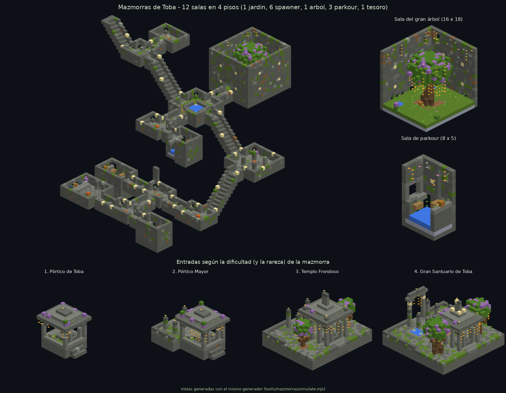
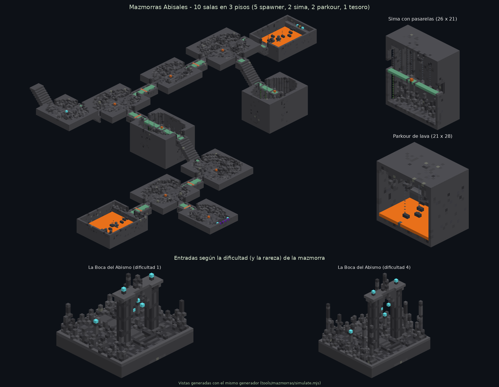
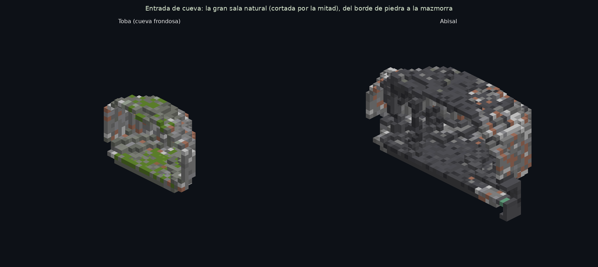
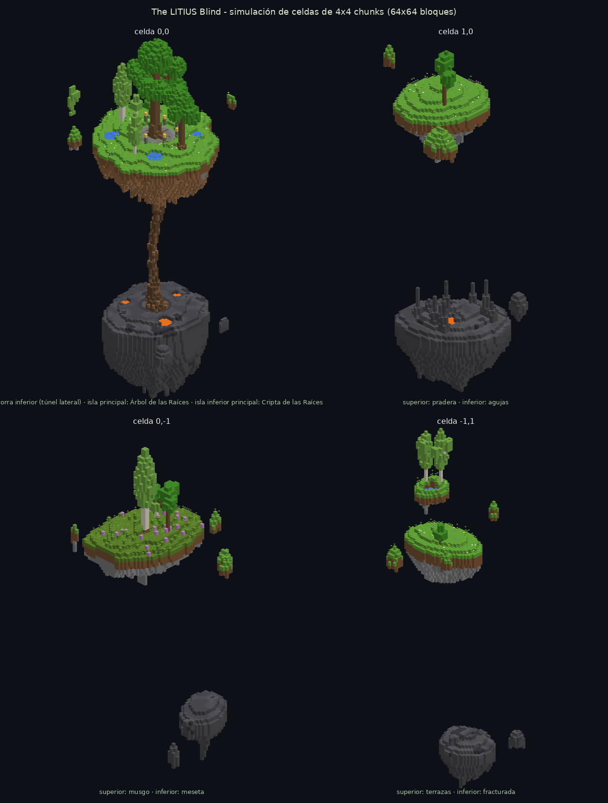
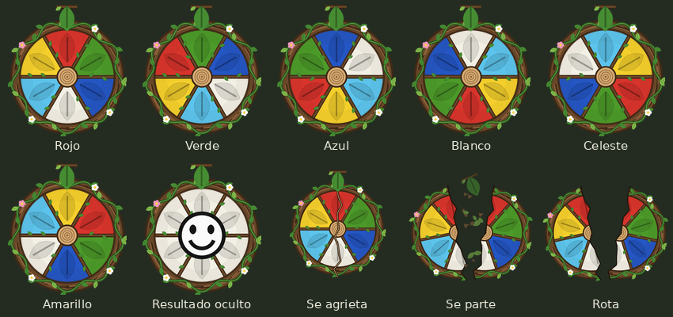
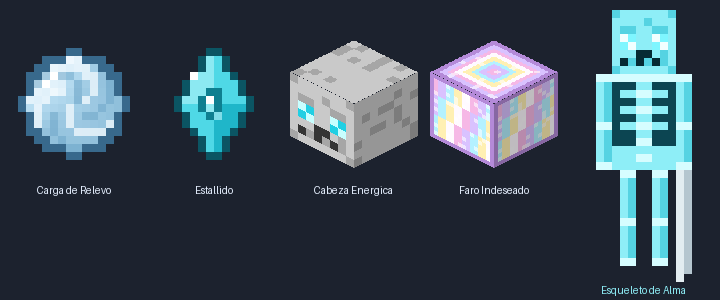
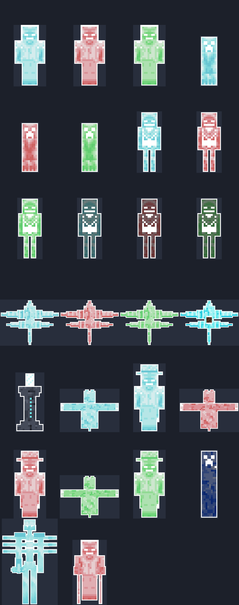
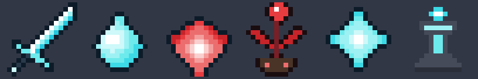
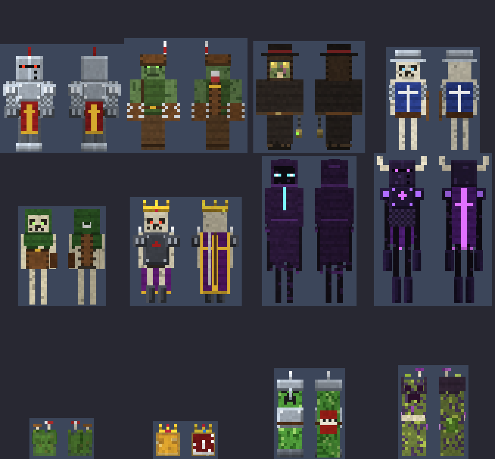

# Addons de mobs para Minecraft Bedrock

| Addon | Descarga | Generador |
|---|---|---|
| **The Revamp of the Soul** (antes Soul Corrupted Mobs; base de Euforia) | [`dist/TheRevampOfTheSoul.mcaddon`](dist/TheRevampOfTheSoul.mcaddon) | `tools/soul_mobs.py` |
| **Medieval Mobs** – mobs medievales | [`dist/MedievalMobs.mcaddon`](dist/MedievalMobs.mcaddon) | `tools/generate.py` |
| **Ruleta de Colores** – ruleta en el HUD con comandos de administrador | [`dist/Roulette.mcaddon`](dist/Roulette.mcaddon) | `tools/roulette.py` |
| **Objetos de Ayuda** – 4 objetos especiales que ayudan al jugador | [`dist/HelperItems.mcaddon`](dist/HelperItems.mcaddon) | `tools/helper_items.py` |
| **The LITIUS Blind** – nueva dimensión de islas flotantes | [`dist/LitiusBlind.mcaddon`](dist/LitiusBlind.mcaddon) | `tools/litius_blind.py` |
| **Mazmorras de Toba** – generador de mazmorras (toba y abisales) con un objeto | [`dist/MazmorrasToba.mcaddon`](dist/MazmorrasToba.mcaddon) | `tools/mazmorras.py` |

Abre el `.mcaddon` y activa el pack *Behavior* en el mundo; el de recursos se añade solo. No hace falta activar experimentos
(salvo en The LITIUS Blind, ver abajo).

- The Revamp of the Soul requiere Minecraft Bedrock **1.26.0** o superior.
- Medieval Mobs requiere **1.21.0** o superior.
- Ruleta de Colores y Objetos de Ayuda requieren **1.21.90** o superior.
- Mazmorras de Toba requiere **1.26.0** o superior (bloques indestructibles con varias cajas de colisión).
- The LITIUS Blind requiere **26.20** o superior y el experimento **Beta APIs**.

---

# Mazmorras de Toba







Genera mazmorras con un objeto: de **toba volcánica** invadidas por plantas de las **cuevas frondosas**, o
**abisales**, cuevas enormes de **pizarra profunda** casi a oscuras. Todos sus bloques son **indestructibles**.

**Cómo usarlo:** coge el **Cetro de las Mazmorras** (`mazmorra:cetro`) del inventario creativo (pestaña de equipo)
o con `/give @s mazmorra:cetro`. Úsalo (clic derecho) y se abre un formulario:

| Opción | Valores |
|---|---|
| Tipo de mazmorra | **Ruinas Frondosas** (equilibrada), **Cripta de Toba** (difícil: más generadores, musgo pálido, baja más), **Jardín Colgante** (muy frondosa, más parkour), **Mazmorras Abisales** (muy difícil, ver abajo) |
| Número de salas | **5 a 30** (10 por defecto) |
| Pisos | 1 a 6 como máximo (4 por defecto; menos si estás muy abajo) |
| Entrada | **Normal** (estructura en la superficie y escalera) o **Cueva** (sin entrada, ver abajo) |
| Salas de parkour | sí / no |
| Semilla | opcional: la misma semilla, tipo y salas dan la misma mazmorra |

Después te muestra un resumen (salas de cada tipo, pisos, qué entrada tendrá y su dificultad, tamaño de la zona) y
pide confirmar. **La entrada aparece donde estás** y la mazmorra baja **hacia donde miras**. Todo lo que haya bajo
tierra en esa zona se reemplaza. Tarda unos segundos (las abisales grandes, hasta un minuto o más); el progreso sale
encima de la barra de objetos.

## Bloques indestructibles

Cada bloque que usan las mazmorras tiene una **copia indestructible** (`mazmorra:<nombre>`, 72 en total): misma
textura que el vanilla, pero no se puede minar ni la rompen las explosiones (en creativo sí se puede quitar). Las
plantas y lo que cuelga (bayas luminosas, raíces, musgo pálido, flores de esporas) no necesitan soporte, así que **ya
no se rompen al generarse**. Las escaleras tienen dos cajas de colisión: se suben andando como las normales. Son un único modelo girado con
`minecraft:transformation`, que gira también la colisión, así que lo que ves y lo que pisas siempre coincide. Las
losas, escaleras y muros no dejan pasar la luz.

En el inventario creativo están en **cuatro grupos desplegables** (con la flechita): *Toba indestructible*,
*Abismo indestructible*, *Luces y adornos indestructibles* (pestaña de construcción) y *Plantas indestructibles*
(pestaña de naturaleza).

Siguen siendo vanilla los bloques que tienen que funcionar: **cofres, bóvedas, generadores de desafío, enredaderas**
(para trepar), el **marco del tótem**, agua y lava. Dentro de una mazmorra el addon impide que un jugador en supervivencia rompa cofres,
bóvedas, generadores, enredaderas y el marco del tótem, y que las explosiones rompan cualquier bloque de la mazmorra.

**Barreras:** en la mitad de cada pasillo **sin escaleras** hay una barrera de **rejillas de cobre** que cierra el
paso. Esas rejillas son normales a propósito: hay que **picarlas** para pasar (las de las pasarelas abisales sí
son indestructibles).

## Mazmorras de toba

- **Salas de todos los tamaños:** cada sala mide entre **5x5 y 18x18** (largo y ancho por separado) y su altura
  crece con el tamaño. Se colocan una a una junto a otra sala, sin chocar nunca, y la mazmorra **tiende a bajar**.
- **Poca luz:** una ranaluz cada 10 bloques de pasillo y una por pared solo en las salas grandes; velas en vez de
  faroles en las salas de generador. El resto de luz la dan las bayas luminosas.
- **Pasillos y escaleras de 3x3**, con vigas de losas, musgo, líquenes y **bayas luminosas** colgando. Las escaleras
  unen pisos (10 bloques entre piso y piso).
- **Salas de generador (5x5 a 18x18):** un **generador de desafío** en el centro; las grandes tienen pilares.
  Se activa solo cuando un jugador se acerca a 6 bloques (sus llamas cambian y suena), sin mensajes ni contador:
  saca enemigos por oleadas (6, +2 por jugador extra, más cuanto mayor es la sala y más difícil la mazmorra). Al
  acabar con todos suelta su recompensa (siempre una **llave de desafío**) y descansa **30 minutos**. Si todos os
  vais, se duerme y se lleva sus mobs. Familias: zombis, esqueletos/pantanosos, arañas, **ahogados**, lepismas o
  breezes (solo a partir del segundo piso).
- **Salas de parkour (8 a 16 de largo, 5 a 7 de ancho):** **losas de madera colgando del techo con cadenas** sobre
  un foso con agua y al otro lado un **cofre con recompensas**. Si caes, el agua amortigua y hay enredaderas para
  volver a subir.
- **Sala del gran árbol (16x16 a 18x18, 16 de alto):** un árbol gigante con raíces, ramas, copa de azalea florida y
  bayas luminosas colgando, estanques con plantaformas y un cofre de ofrendas al pie del tronco.
- **Torre del Tótem (20 de largo, 40 de alto):** una por mazmorra (desde 6 salas). Entras arriba y abajo del todo
  hay **lava**. Un parkour de **cornisas en las paredes** (losas sobre escaleras invertidas) y **losas colgadas de
  cadenas** da vueltas a la torre mientras baja, hasta un **altar majestuoso** sobre un pedestal que sale de la
  lava: escalinata, tarima de ladrillos cincelados, pilares con velas, azaleas, dos faroles colgados de cadenas
  larguísimas y, en la pared del fondo, un **marco luminoso con un tótem de la inmortalidad**. Todos los saltos se
  pueden hacer de vuelta (como mucho un bloque hacia arriba), así que se sale por donde se entró.
- **Jardines (7x7 a 15x15)** y **sala del tesoro (9x9 a 15x15)** con un **generador ominoso** guardián, el cofre del
  tesoro y una **bóveda** y una **bóveda ominosa**.

**Entrada de cueva** (las dos clases de mazmorra): no hay nada en la superficie. La mazmorra empieza en una **gran
sala natural**, más grande que todas las demás (20 a 26 bloques en toba, 34 a 38 en las abisales), con forma de
cueva y sin muros alrededor: se junta con la piedra y las cuevas del terreno. Sus bloques hacen un **degradado**:
en el borde piedra, andesita, diorita, granito y piedra labrada (o pizarra profunda y toba si está bajo y=0) y,
hacia el centro, los materiales de la mazmorra (toba con musgo, bayas, plantaformas y flores de esporas; o
pizarra profunda con picos). De su parte trasera salen 2 o 3 **túneles** sinuosos que suben y se meten en la piedra
(acaban ciegos o se cruzan con cuevas). Se genera **donde estás**: si estás demasiado cerca de la superficie, la
sala se hunde lo necesario (el resumen dice cuántos bloques). Esa piedra natural es normal (se puede picar).

**Entradas:** cuanto más difícil es la mazmorra (más salas, más pisos, Cripta > Jardín > Ruinas), más majestuosa
es su entrada. Además, el 12 % de las mazmorras son **raras** y suben un nivel de entrada.

| Nivel | Entrada |
|---|---|
| 1 | **Pórtico de Toba:** porche de cuatro pilares con tejado de tres niveles, musgo, azaleas y bayas colgando, sobre la escalera de 3x3 que baja 16 bloques al vestíbulo. |
| 2 | **Pórtico Mayor:** además, un patio empedrado delante con muretes, obeliscos con faroles y jardineras de azalea. |
| 3 | **Templo Frondoso:** patio más grande, porche más alto con columnata, aguja en el tejado, obeliscos altos y dos árboles de azalea a los lados. |
| 4 | **Gran Santuario de Toba:** todo lo anterior más una gran puerta de 9 bloques con cortina de bayas luminosas, dos estanques con plantaformas, árboles más grandes y una corona de ranaluces en la aguja. |

## Mazmorras abisales

Son las más ambiciosas: **cuevas** de pizarra profunda (labrada, pulida, ladrillos, baldosas, agrietada, cincelada),
basalto liso y toba, con **casi ninguna luz** (un farol de almas en algunas salas, algún liquen y vetas de obsidiana
llorosa; algo más de luz que en la versión anterior: un farol de almas en cada sala y más liquen). Dificultad
alta: la entrada siempre es grandiosa.

- **Salas de 20x20 a 32x32**, con forma de cueva: paredes irregulares, techos en bóveda, **suelos en relieve hechos
  con losas** (cada escalón es medio bloque), **escaleras al pie de las paredes y escaleras invertidas bajo el techo**,
  y **picos de pizarra** (estalagmitas y estalactitas) que se afilan con escaleras y losas; los grandes tienen base
  ancha. Los caminos de las puertas al centro siempre quedan llanos.
- **Pasillos largos** (8 a 18 bloques) de 5 de ancho: el suelo es una **pasarela de rejilla de cobre** sobre un
  hueco, **sostenida por cadenas** cada pocos bloques. Las escaleras son de ladrillos de pizarra profunda.
- **Cavernas (generador):** cueva con un generador de desafío en el centro, sobre un anillo de baldosas.
- **Simas (generador):** la sala es un abismo de 16 bloques. **Pasarelas de rejilla colgadas de cadenas** van de
  cada puerta a una **plataforma central** donde espera el generador. Abajo, picos. Junto a cada puerta hay
  enredaderas para volver a subir si caes.
- **Parkour de lava (24 a 32 de largo):** un lago de lava con **losas de baldosas colgando de cadenas**, bloques
  cincelados colgantes y **pilares que salen de la lava**, saltos de 1 o 2 bloques que cambian de lado y de altura,
  y el cofre al fondo.
- **Tesoro:** tarima con escaleras, el cofre entre una bóveda y una bóveda ominosa, obsidiana llorosa y un
  generador ominoso guardián.
- Mobs: esqueletos/esqueletos de las nieves, zombis, arañas, lepismas, **blazes** y breezes (desde el segundo piso);
  el guardián saca **esqueletos wither**, blazes y esqueletos de las nieves.
- **La Boca del Abismo (entrada):** una plaza de baldosas de pizarra rodeada de **dientes de piedra** (picos), con
  cuatro picos gigantes en las esquinas, una **puerta colosal** de dos pilares de 3x3 (17 a 23 bloques de alto según
  la dificultad) con bases y capiteles de escaleras, un **arco apuntado** con clave cincelada y una aguja encima,
  faroles de almas colgando sobre una **escalera de 5 de ancho** que baja al vestíbulo, obeliscos y un camino
  flanqueado por picos. A partir de dificultad 3, dos picos gigantes más junto a la puerta.

Notas:
- **Qué sigue ejecutándose después de generar:** el script no se apaga. Cada medio segundo revisa los generadores
  de desafío de las mazmorras (solo los que están en zonas cargadas: mira si hay un jugador cerca, saca mobs,
  suelta recompensas y cuenta el descanso). Además escucha cuando alguien usa el cetro y, para la protección,
  cuando un jugador rompe un bloque o algo explota (comprueba si es dentro de una mazmorra). No usa comandos salvo
  `/tickingarea` mientras genera (y coloca la estructura del tótem). Los generadores y las zonas de las mazmorras se guardan en el mundo.
- El generador de desafío de vanilla solo funciona con datos que los scripts no pueden poner, así que el addon
  lo controla él mismo (el bloque cambia de estado: esperando, activo, soltando recompensa, enfriamiento).
  Dentro de la mazmorra solo se puede romper en creativo; si lo rompes, deja de funcionar.
- Para generar lejos de los jugadores el addon crea una zona de carga temporal (`/tickingarea`) por cada trozo
  de unos 80x80 bloques y la quita al acabar. Necesita que haya hueco (máximo 10 zonas en el mundo).
- Si no caben todas las salas pedidas (muy raro), el resumen lo dice.
- Solo se puede generar una mazmorra a la vez.
- El marco con el tótem es una estructura del pack (`structures/mazmorra/totem_*.mcstructure`, escrita por
  `tools/mcstructure.py`): un script no puede meter un objeto en un marco, una estructura sí.
- El generador está en `tools/mazmorras/gen.js` y se copia tal cual al pack; `CONFIG` en `tools/mazmorras.py`
  cambia los tiempos, número de mobs y recompensas de los generadores. `node tools/mazmorras/simulate.mjs check 90`
  genera 90 mazmorras al azar (de los 4 tipos) y comprueba que ninguna sala se solapa y que se llega andando a todas.
- Las copias indestructibles se generan con `tools/mazmorras_clones.py`, que usa las texturas del juego vanilla. Al
  construir, se comprueba que todos los bloques que puede poner el generador tienen copia.

---

# The LITIUS Blind



Una nueva dimensión de **islas flotantes sobre el vacío**, en dos capas.

**Cómo activarlo:** en los ajustes del mundo, *Experimentos → Beta APIs* activado, y el pack *Behavior* activo.
Las dimensiones nuevas en Bedrock solo se pueden crear con la *Custom Dimension API*, que de momento es beta
(Minecraft **26.20** o superior). Sin ese experimento el addon no carga.

**Cómo entrar:** con la **Llave de Raíces** (`litius:llave_de_raices`). Por ahora **no se puede craftear ni
conseguir** de ninguna forma: no está en el inventario creativo ni en ningún cofre. Solo con
`/give @s litius:llave_de_raices`. Al usarla te lleva a la isla principal; usada dentro de la dimensión te devuelve
al sitio desde el que entraste. Cooldown 3 s.

| | Islas superiores | Islas inferiores |
|---|---|---|
| Altura | capa **80 hacia arriba** | capas **20 a 50** |
| Bloques | césped o musgo arriba, tierra, y piedra/andesita debajo; **rara vez minerales** | solo bloques de deepslate: deepslate, pizarra empedrada, pulida, baldosas, ladrillos, cincelada y menas de deepslate (raras) |
| Agua / lava | oasis, ríos y lagunas | solo **lagos de lava** |
| Árboles | robles majestuosos (tronco 2x2, raíces y ramas), robles elaborados, abedules majestuosos y abedules gigantes | – |
| Mazmorras | 12 % de las islas, entrada por una **escalera que baja** desde la superficie | 55 % de las islas (más frecuentes), entrada por un **túnel lateral** o una escalera |

- **Tamaño:** las islas miden entre ~20 y ~45 bloques de ancho, un 35 % más pequeñas que las islas del End,
  con huecos de aproximadamente 10–40 bloques entre ellas (ni muy juntas ni muy lejos). Debajo tienen forma de gota,
  con colgajos de piedra.
- **Variedad:** islas superiores de pradera, bosque, musgo (con azaleas), oasis, río, lagunas, colinas
  (rocas al aire), archipiélago, anillo (con agujero en medio) y terrazas (una isla flotando sobre otra), más
  islotes alrededor. Islas inferiores de meseta, agujas, cráter (gran lago de lava), fracturada (partida por una
  grieta), escalones y archipiélago.
- **Isla principal:** más grande (60 bloques), con una plaza de ladrillos de piedra y musgo, farolas, cuatro
  estanques y el **Árbol de las Raíces**, un roble gigante con tronco 3x3 cuyas **raíces caen por el vacío** hasta
  la isla inferior principal (la *Cripta de las Raíces*, con su mazmorra). Debajo de la isla cuelgan raíces.
- **Mazmorras sin mobs:** sala de piedra musgosa (arriba) o de ladrillos de deepslate (abajo), con 1–2 cofres de
  botín, telarañas, farolillos y un altar vacío donde estaría el generador. No hay generadores de mobs.
- **Sin mobs:** por ahora no puede aparecer ningún mob en la dimensión (tampoco con huevos); se eliminan al aparecer.
- **Simulación por celdas de 4x4 chunks:** la dimensión se genera en celdas de 4x4 chunks (64x64 bloques); cada
  celda tiene un grupo de islas superiores y casi siempre uno inferior. Se generan las 5x5 celdas alrededor de cada
  jugador, la más cercana primero, cargándolas con una zona de carga temporal. La imagen de arriba es la simulación
  de cuatro celdas hecha con el mismo generador (`python3 tools/litius_blind.py --preview`, necesita `node`).
- La forma de las islas depende de una semilla propia que se guarda en el mundo la primera vez.
- Debajo de las islas solo hay vacío: cuidado al saltar entre ellas.
- El generador está en `tools/litius_blind/gen.js` y se copia tal cual al pack; `CONFIG` en `tools/litius_blind.py`
  cambia el radio de generación.

---

# Ruleta de Colores



Comandos para el administrador (operador) del mundo. La ruleta aparece en la **esquina inferior derecha**
de la pantalla de los jugadores y gira hasta caer en el color que elijas.
Tiene 6 colores: **rojo, verde, azul, blanco, celeste y amarillo**.

| Comando | Qué hace |
|---|---|
| `/roulette:show` | Muestra la ruleta. |
| `/spin_roulette:rojo` | Gira la ruleta y la hace caer en rojo. Si estaba oculta, la muestra. |
| `/spin_roulette:verde`, `:azul`, `:blanco`, `:celeste`, `:amarillo` | Igual, con los otros colores. |
| `/spin_roulette:aleatorio` | Gira la ruleta y cae en un color al azar. |
| `/roulette:hide` | Oculta la ruleta. |

- Todos aceptan un selector de jugadores al final, por ejemplo `/spin_roulette:azul @a[tag=juego]`.
  Sin selector se aplican a todos los jugadores.
- Los mismos comandos funcionan con `/scriptevent` (por ejemplo en bloques de comandos):
  `/scriptevent spin_roulette:rojo`, `/scriptevent roulette:show` y `/scriptevent roulette:hide`.
- El giro dura 6 segundos: da varias vueltas, frena poco a poco y suena un clic en cada color.
  Al parar, el color sale en la barra de acción y en el chat.
- El resultado se guarda en el marcador `ruleta`, jugador `resultado`
  (1 rojo, 2 verde, 3 azul, 4 blanco, 5 celeste, 6 amarillo).
- Si un jugador sale y vuelve a entrar con la ruleta abierta, la vuelve a ver.
- La ruleta se dibuja con JSON UI usando títulos ocultos que empiezan por `_roul:`; el resto de títulos se ve normal.
  El tamaño, la esquina y la duración del giro se cambian en `tools/roulette.py` (`UI_SIZE`, `ANCHOR`, `SPIN_TICKS`).

---

# Objetos de Ayuda



Cuatro objetos especiales. Están en el inventario creativo o con `/give @s <id>`.

| Objeto | ID | Qué hace |
|---|---|---|
| Carga de Relevo | `ayuda:carga_de_relevo` | Te impulsa unos **15 bloques hacia arriba** y te da **Caída lenta 15 s** (empieza al llegar arriba). **70 usos** (se gasta uno por uso), **cooldown 30 s**, no se apila. Icono 2D: una bola de viento esférica. |
| Estallido | `ayuda:estallido` | Te cuesta **3 corazones** (primero se gastan los dorados si tienes Absorción) y provoca una explosión que **no rompe bloques ni te daña**. Cada mob a **3 bloques** o menos recibe 3 corazones de daño, sale empujado unos **4 bloques** y recibe **Lentitud II 5 s**. **Cooldown 45 s**, no se apila. 2D en el inventario y **3D en la mano** (rombo celeste que gira). Sin Absorción y con 3 corazones o menos no se puede usar, para no matarte. |
| Cabeza de Esqueleto Enérgica | `ayuda:cabeza_esqueleto_energica` | Cabeza de esqueleto con **ojos celestes**, 3D en el inventario y en la mano. Al usarla aparece un **Esqueleto de Alma** aliado. **Cooldown 45 s**; no se gasta. |
| Faro Indeseado | `ayuda:faro_indeseado` | Bloque brillante tipo ranaluz (nacarado), 3D en el inventario y en la mano. Al usarlo te da un **efecto positivo aleatorio, nivel II, durante 24 s**. Nunca da efectos instantáneos (salud instantánea, saturación). Se gasta al usarlo. |

- La cabeza y el faro son bloques (por eso se ven en 3D): **úsalos apuntando a un bloque** como si los colocaras, o al aire.
  No se quedan colocados; colocarlos cuenta como usarlos.
- Los cooldowns se reinician si sales y vuelves a entrar al mundo.

### Esqueleto de Alma (`ayuda:esqueleto_de_alma`)

- Textura de esqueleto vanilla (64x32, píxeles de 16x16) en **celeste fuego de almas**, con una espada.
- **80 de vida** (4 esqueletos), velocidad **0,253** (un 10 % más que el zombi) y **6 de daño** (3 corazones sin armadura).
- Es tuyo: te sigue, ataca a los monstruos cercanos (menos creepers), a quien te ataca y a quien atacas. No le hace daño la caída ni el fuego.
- Animaciones:
  - **Aparecer**: sale del suelo arrastrándose (0,5 s).
  - **Caminar**: lleva la espada con las dos manos y se inclina hacia delante.
  - **Atacar**: echa la espada atrás y da una estocada hacia delante.
  - **Morir**: se encoge hasta desaparecer.
- Los valores (vida, daño, radio, empuje, duraciones...) están en `CONFIG` y `SKELETON_STATS` al principio de `tools/helper_items.py`.

---

# The Revamp of the Soul





La base es el addon original *Soul Corrupted Mobs v1.0.0*: sus texturas, el **outline blanco**,
las animaciones vanilla y los identificadores `eu_sc:`. Se guarda sin cambios en `sources/soul_corrupted_mobs_v1.0.0/`.
El generador `tools/soul_mobs.py` (con `tools/soul_bosses.py`) lo copia y le añade todo lo demás.

| Mob | IDs |
|---|---|
| Zombi de Alma Corrupta | `eu_sc:soul_corrupted_zombie` (azul, original) / `_red` / `_green` |
| Creeper de Alma Corrupta | `eu_sc:soul_corrupted_creeper` / `_red` / `_green` |
| Esqueleto de Alma Corrupta | `eu_sc:soul_corrupted_skeleton` / `_red` / `_green` |
| Phantom de Alma Corrupta (4 alas puntiagudas, 2,5 veces más grande) | `eu_sc:soul_corrupted_phantom` / `_red` / `_green` |
| Phantom de Alma Domable (montable) | `eu_sc:soul_corrupted_phantom_mount` |
| Esqueleto Wither de Alma Corrupta | `eu_sc:soul_corrupted_wither_skeleton` / `_red` / `_green` |
| Araña de Alma Corrupta (1,3 veces más grande, aspecto monstruoso) | `eu_sc:soul_corrupted_spider` / `_red` / `_green` |
| Zombi Invocador de Alma Corrupta (sombrero de granjero y capa) | `eu_sc:soul_corrupted_summoner` / `_red` / `_green` |
| **Sub-jefe**: Creeper Titán de Alma Corrupta (azul marino) | `eu_sc:soul_corrupted_creeper_titan` |
| Esqueleto Encapotado (variante vanilla, sin alma) | `eu_sc:caped_skeleton` |
| **Mini jefe**: Esqueleto Mutante de Alma Corrupta | `eu_sc:soul_mutant_skeleton` |
| **Mini jefe**: Zombi Cuchilla de Alma Corrupta | `eu_sc:soul_blade_zombie` |
| Altar de Curación | `eu_sc:healing_altar` |

### Progresión

1. Los mobs de alma sueltan **Esencia de Alma**: un 9 % de probabilidad, más con Botín. Todos los drops son un 75 % menos frecuentes.
2. **Planta de Alma Corrupta**: 4 esencias, hongo carmesí y tierra de almas. Úsala para invocar al **Zombi Cuchilla**.
3. El Zombi Cuchilla suelta el **Núcleo de Alma**.
4. **Estrella de Alma Corrupta**: 7 esencias, el núcleo y un diamante. Úsala para invocar al **Esqueleto Mutante**.
5. El Esqueleto Mutante suelta la **Espada de Alma Corrupta** (siempre).

### Mini jefes (sin barra de vida)

**Esqueleto Mutante (azul):**
- Usa el modelo de Mutant Creatures: modelo, textura recoloreada y animaciones, guardados en `sources/mutant_skeleton/`.
- Mide el doble que un jugador y tiene 400 de vida.
- Su espada mide unos 2,4 bloques: hoja ancha con filos blancos, guarda con puntas y pomo.
- Ataca con una espada gigante y hace un **slash épico**.
- De vez en cuando lanza una **explosión** que no rompe bloques: te empuja y te deja **ciego 3 s**.
- **Entrada**: cae del cielo, aterriza agachado y se levanta.
- **Muerte**: se arrodilla y se desploma. Después invoca un creeper y un zombi de alma.

**Zombi Cuchilla (rojo):**
- Tamaño de jugador, con cuchillas en vez de brazos.
- 400 de vida y velocidad 0,33.
- Su ataque normal es exagerado: echa las cuchillas atrás y se lanza con ellas hacia delante.
- **Explosión**: lentitud II 3 s.
- **Embestida**: si te alcanza, lentitud 255 durante 1 s.
- **Invoca zombis rojos** (máximo 4 cerca).
- **Entrada**: sale del suelo.
- **Muerte**: algo lo arrastra bajo tierra mientras se resiste.

### Nuevos mobs

**Araña de Alma Corrupta:**
- Ocho ojos blancos, colmillos, abdomen con púas y patas con garras.
- Trepa paredes y salta sobre el jugador.

**Zombi Invocador:**
- Cuando te ve invoca un zombi y un esqueleto de su mismo color: levanta los brazos y salen del suelo.
- Lo repite cada 30 s, y nunca si ya hay muchos mobs de alma cerca.

**Creeper Titán (sub-jefe):**
- Solo existe en azul marino, con outline. Más alto que un creeper y con patas largas: unos 2,25 bloques.
- Al aparecer provoca una mini explosión que no rompe bloques.
- Al explotar deja un creeper de alma celeste normal.
- Aparece rara vez, en el Overworld y en el Nether.

**Esqueleto Encapotado:**
- Un esqueleto vanilla, con su textura normal, que lleva capa y capucha.
- Dispara 2 flechas seguidas.

### Esqueleto Wither de Alma Corrupta

- Hay uno en cada color, más oscuro y con el tamaño normal de un wither skeleton (1,2 veces un esqueleto).
- Corre a 0,4 (el wither skeleton normal va a 0,25), con una carrera exagerada: inclinado y con los brazos hacia atrás.
- Su **slash** hace 60 de daño: mata de un golpe aunque lleves armadura de hierro completa.
- **Muere de un golpe** (1 de vida) y no suelta nada.

### Resto

- **Colores**: más suaves y apagados que antes, con el outline blanco. El altar y el phantom domable conservan sus colores.
- **Inclinación al ir hacia el objetivo**: el zombi se inclina un poco más que el creeper y el esqueleto, menos que los dos.

- **Al golpear**: Oscuridad, más un extra según el color:
  - azul: lentitud.
  - rojo: prende fuego.
  - verde: veneno.
- Las flechas de los esqueletos invocan rayos, en los tres colores.
- **Inmunes** a fuego, lava, magma, congelación, ahogamiento y wither. No se convierten en ahogados ni en *strays*.
- Caminan un 12 % más rápido que sus versiones vanilla.
- **Spawn natural**: los mobs de alma son aproximadamente **el 35 %** de los monstruos que aparecen en sus biomas. Las probabilidades de cada bioma se calculan a partir de cuánto aparecen ahí los mobs vanilla.
  - Azules: solo en el Nether (valle de arena de almas, bosque distorsionado y deltas de basalto).
  - Rojos: solo en el Nether (bosque carmesí y desiertos del Nether).
  - Verdes: solo en el Overworld, en cualquier bioma salvo sabanas y biomas fríos.
  - Phantoms: el 35 % de los phantoms vanilla (los del insomnio) se convierte en phantoms de alma verdes.
- **Oscuridad**: dura 2 segundos.
- **Phantoms**:
  - todos vuelan 1,65 veces más rápido;
  - el hostil detecta jugadores a 96 bloques, ataca cada 2-5 s y vuela a 6-12 bloques sobre ti;
  - el domable se domestica con huesos y se monta como el happy ghast, a 0,033 de velocidad (happy ghast: 0,016).
- **Altar de Curación**:
  - mide 2 bloques, es inmune a todo daño y siempre mira hacia el mismo lado;
  - a **12 bloques** o menos te lanza un rayo de partículas y te cura 1 de vida por segundo;
  - se recoge agachado + interactuar;
  - receta: `C F C / C M C / C C C` (C = pizarra profunda rocosa, F = farol de almas, M = manzana dorada).
- **Espada**: 9 de daño, Wither II + quemadura, daño en área, y lleva el tag `minecraft:is_sword`.

---

# Medieval Mobs

12 mobs **nuevos e independientes** (no reemplazan a los vanilla) inspirados en los
zombis, esqueletos, slimes, endermen y creepers, con aspecto medieval, modelos
propios y golpes que dejan **efectos negativos**.



## Los mobs

Cada mob tiene su propio identificador, su huevo de generación, sus reglas de spawn y su botín.
Los efectos de la columna "Al golpear" se aplican en cada golpe, flecha o explosión.

| Mob | ID | Qué hace | Al golpear |
|---|---|---|---|
| Caballero Zombi Caído | `medieval:zombie_knight` | Yelmo con visor y cresta, armadura completa, tabardo con cruz y espada de hierro. Resiste el empuje | Lentitud II, Debilidad |
| Zombi Lanzaflechas | `medieval:zombie_archer` | **Lanza flechas a puñetazos**, en ráfagas de dos con sus guanteletes gigantes. Lleva carcaj y gorro con pluma | Veneno, Hambre |
| Zombi de la Peste | `medieval:zombie_plague` | Médico de la peste: máscara de pico, sombrero, túnica larga e incensario | Náusea, Veneno, Hambre II |
| Esqueleto Espadachín | `medieval:skeleton_swordsman` | **Cuerpo a cuerpo** con espada, escudo en el brazo, gambesón y casco de hierro | Debilidad, Lentitud |
| Esqueleto Arquero Real | `medieval:skeleton_longbowman` | **A distancia** con arco y flechas de lentitud. Capucha verde y carcaj | Lentitud II, Debilidad |
| Señor de la Guerra Esqueleto | `medieval:skeleton_warlord` | **Combina las dos**: arco de lejos y espada al acercarte (cambia solo). Corona, capa y armadura negra. Es raro | Wither (cuerpo a cuerpo), Debilidad (flechas), Ceguera, Lentitud II |
| Slime del Pantano | `medieval:bog_slime` | **Mucho más rápido** que un slime normal. Musgo y setas encima. Se divide al morir | Veneno, Lentitud |
| Slime Real | `medieval:royal_slime` | **Rápido**, dorado, con corona y capa. Vive bajo tierra y se divide al morir | Debilidad, Fatiga minera, Náusea |
| Espectro del End | `medieval:ender_wraith` | Enderman encapuchado con túnica rasgada. Ataca a los jugadores cercanos aunque no lo mires | Ceguera, Wither |
| Caballero del End | `medieval:ender_knight` | Yelmo de obsidiana con cuernos, armadura, capa y espada. Neutral como el vanilla | Lentitud, Fatiga minera II, Levitación |
| Creeper de Asedio | `medieval:siege_creeper` | **Ataca y explota a la vez**: al golpearte enciende la mecha y sigue pegando mientras se hincha. Casco y barril de TNT. Explosión más fuerte | Lentitud, Debilidad |
| Creeper Pestilente | `medieval:plague_creeper` | **Ataca y explota a la vez**. Capucha, hongos y pústulas | Veneno, Náusea, Hambre II |

## Spawneo

- **Natural**: salen de noche o en la oscuridad, como los monstruos vanilla y junto a ellos.
  - El Slime del Pantano sale en pantanos y manglares.
  - El Slime Real sale bajo tierra, por debajo de Y=40.
  - Los endermen medievales también salen en el End.
- **Generadores (spawners)**: usa el huevo del mob sobre un generador de monstruos.
  Funciona igual que con los huevos vanilla.
- **Comandos**: `/summon medieval:skeleton_warlord`.
- **Huevos**: están en el inventario creativo, en la sección de huevos de generación.

## Estructura del proyecto

```
TheRevampOfTheSoul_BP/  TheRevampOfTheSoul_RP/  The Revamp of the Soul (generado)
sources/mutant_skeleton/                      modelo de Mutant Creatures (con permiso)
sources/soul_corrupted_mobs_v1.0.0/           addon original (base)
MedievalMobs_BP/   MedievalMobs_RP/    addon medieval
Roulette_BP/       Roulette_RP/        ruleta de colores (generado)
HelperItems_BP/    HelperItems_RP/     objetos de ayuda (generado)
tools/             generadores en Python (modelos + texturas + JSON)
dist/              los .mcaddon listos para instalar
```

Los packs se generan con Python 3 y Pillow. Para cambiar vida, daño, efectos, colores o modelos:

1. Edita las tablas al principio del generador:
   - The Revamp of the Soul: `COLORS`, `BASE_MOBS`, `PHANTOM` y `WITHER` en `tools/soul_mobs.py`, y `BOSSES` en `tools/soul_bosses.py`.
   - Medieval Mobs: `MOBS` en `tools/generate.py`, y los modelos en `tools/models.py`.
2. Ejecuta el generador:

```
python3 tools/soul_mobs.py --preview
python3 tools/generate.py --preview
python3 tools/roulette.py --preview
python3 tools/helper_items.py --preview
```

Cada uno vuelve a generar sus packs y su `.mcaddon`. `--preview` además actualiza las imágenes de `docs/`.
