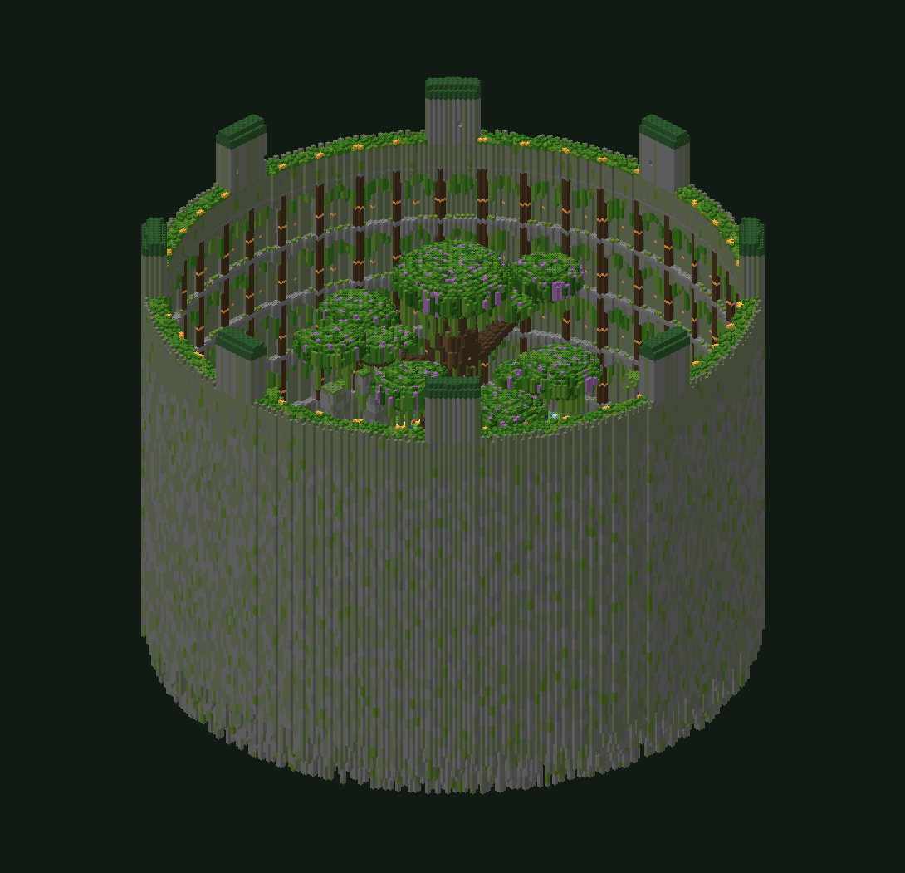
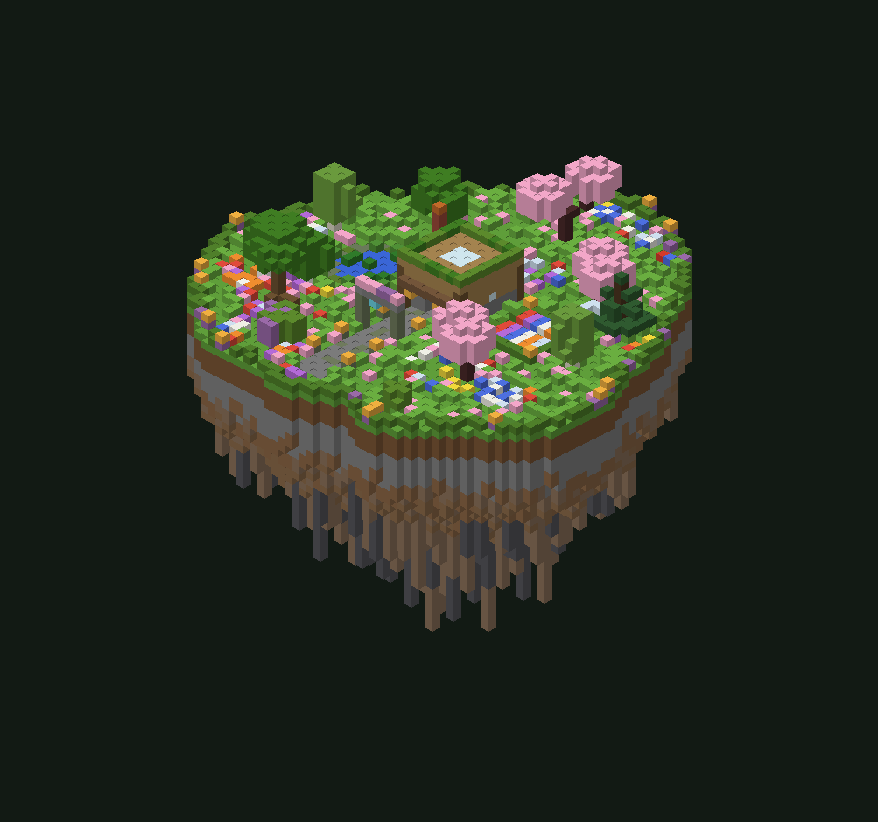
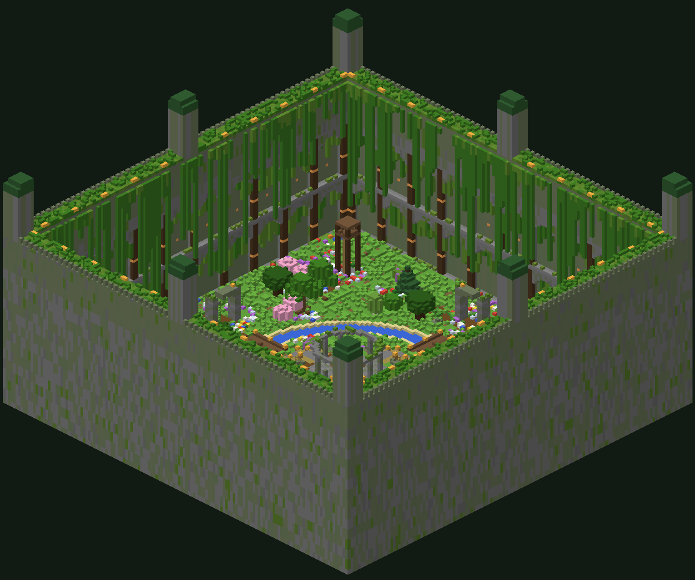

# Addons de mobs para Minecraft Bedrock

| Addon | Descarga | Generador |
|---|---|---|
| **The Revamp of the Soul** (antes Soul Corrupted Mobs; base de Euforia) | [`dist/TheRevampOfTheSoul.mcaddon`](dist/TheRevampOfTheSoul.mcaddon) | `tools/soul_mobs.py` |
| **Medieval Mobs** – mobs medievales | [`dist/MedievalMobs.mcaddon`](dist/MedievalMobs.mcaddon) | `tools/generate.py` |
| **Ruleta de Colores** – ruleta en el HUD con comandos de administrador | [`dist/Roulette.mcaddon`](dist/Roulette.mcaddon) | `tools/roulette.py` |
| **Objetos de Ayuda** – 4 objetos especiales que ayudan al jugador | [`dist/HelperItems.mcaddon`](dist/HelperItems.mcaddon) | `tools/helper_items.py` |
| **The LITIUS Blind** – nueva dimensión de islas flotantes | [`dist/LitiusBlind.mcaddon`](dist/LitiusBlind.mcaddon) | `tools/litius_blind.py` |
| **Natura PvP** – mapa PvP automatizado (Emparejamiento, Caza y Campal) | [`dist/NaturaPvP.mcworld`](dist/NaturaPvP.mcworld) (mundo) · [`dist/NaturaPvP_Aternos.zip`](dist/NaturaPvP_Aternos.zip) (servidor) · [`dist/NaturaPvP.mcaddon`](dist/NaturaPvP.mcaddon) | `tools/natura_pvp.py` |

Abre el `.mcaddon` y activa el pack *Behavior* en el mundo; el de recursos se añade solo. No hace falta activar experimentos
(salvo en The LITIUS Blind, ver abajo).

- The Revamp of the Soul requiere Minecraft Bedrock **1.26.0** o superior.
- Medieval Mobs requiere **1.21.0** o superior.
- Ruleta de Colores y Objetos de Ayuda requieren **1.21.90** o superior.
- The LITIUS Blind requiere **26.20** o superior y el experimento **Beta APIs**.
- Natura PvP requiere **1.21.100** o superior (sin experimentos). Es un **mundo**: abre el `.mcworld`.

---

# Natura PvP



Un **mapa PvP automatizado** ambientado en la naturaleza: un lobby colosal, tres modos con varios
mapas y modo espectador. El lobby y todas las arenas están rodeados de **murallas colosales**, así que aunque
tengas la distancia de renderizado al máximo no se ve nada de fuera. Todo lo demás del mundo está **completamente vacío**. El mapa **viene ya construido** dentro del mundo:
se abre y se juega, sin esperar.

**Cómo usarlo:** abre `dist/NaturaPvP.mcworld` (Minecraft Bedrock **1.21.100** o superior, sin experimentos). Se
importa como un mundo nuevo con los packs ya activados.

### En un servidor (Aternos)
Usa `dist/NaturaPvP_Aternos.zip`: es el mismo mundo dentro de una carpeta `NaturaPvP/`, con los packs ya puestos y
el pack de recursos **obligatorio** al entrar (así todos descargan las canciones).

1. Crea un servidor de **Bedrock** en Aternos con la versión más reciente.
2. En **Mundos**, pulsa **Subir** y elige `NaturaPvP_Aternos.zip`. Cuando termine, selecciona el mundo *NaturaPvP*.
3. En **Jugadores → Operadores**, añade tu nombre de Xbox.
4. Inicia el servidor y entra: el mapa ya está construido.
5. Hazte admin con `/natura:hacer_admin TuNombre` (o `/tag TuNombre add admin`).

No hace falta activar experimentos ni trucos.


| Zona | Tamaño | Dónde |
|---|---|---|
| Lobby (Árbol del Mundo) | isla flotante de ~130 bloques; el árbol mide ~100 de alto; muralla en anillo de 96 bloques | 0, 100, 0 |
| Emparejamiento | **4 mapas** de **64x64** con murallas de **70 bloques** | z 320; x -160, 0, 160 y 320 |
| Campal | **126x126**, murallas de **60 bloques** | 320, 80, 0 |
| Caza | **3 mapas** de **365x365** con murallas de **~90 bloques** en el borde | (0, -480), (-560, 0) y (560, -480) |
| Isla de la victoria | isla flotante de ~50 bloques con la casita segura | 0, 150, 700 |
| Pasillo secreto | **520 bloques** de largo, 28 de ancho y ~100 de alto | 0, 80, -1200 |

**Murallas colosales:** todas tienen 6 bloques de grosor y, por dentro, una **arcada de varios pisos como un
coliseo**: arcos hondos entre pilares de troncos con luces, una cornisa en cada piso, almenas con faroles y una
corona de hojas arriba, y **torres** más altas en las esquinas y a lo largo del muro. **Solo las del lobby tienen
lianas** (cortinas de hojas colgando de los arcos); las de los mapas están limpias. La del lobby es un anillo que flota en el vacío alrededor de la isla, con 8 torres y los cimientos colgando como un
acantilado.

**El clima está desactivado:** nunca llueve ni hay tormentas.

### Lobby: el Árbol del Mundo
Una isla flotante enorme con el **Árbol del Mundo** en el centro: un tronco de unos 22 bloques de ancho (más con
la base) y ~100 de alto, raíces gigantes por las que se puede caminar, ramas que salen a 30 bloques del tronco con copas enormes y
cortinas de hojas, un anillo de **pilares antiguos** de hasta 55 bloques y una plaza alrededor del tronco. Apareces
en la plaza, mirando hacia arriba al árbol.

- **Vista épica al entrar:** cada vez que entras al mundo, la cámara se queda quieta en un ángulo bonito del lobby
  (con un fundido). En la barra de acción sale el aviso: *muévete un bloque hacia delante para entrar al lobby*. Al
  moverte, otro fundido y ya estás en el lobby. Se puede quitar en **Opciones**.
- **La canción al entrar:** el juego todavía está cargando cuando apareces, y la primera canción se perdía. Ahora
  *Your New Forever* empieza en cuanto te mueves (o a los 5 segundos si no te mueves).

- **Tres puertas de piedra de 40 bloques** de alto, una por modo, con su plataforma debajo: al pisarla entras
  (diamante = Emparejamiento al norte, redstone = Caza al oeste, esmeralda = Campal al este). Encima de cada una
  hay un texto con la cola y el **top 3**.
- **Sala de apuestas** (en mantenimiento): dentro del tronco hay una sala para hacer apuestas amigables entre
  jugadores. Por ahora está **cerrada**: su puerta, delante del spawn, está tapada con bloques **amarillos y
  negros** en diagonal y encima pone *Sala de apuestas (mantenimiento)*.
- **Brújula** (*Menú de Natura PvP*): los modos (o salir de la cola), **espectar**, la **Caza del jefe**
  (próximamente), la sala de apuestas, las estadísticas y el ranking, y las **Opciones**. En el lobby no se recibe
  daño ni se pasa hambre.
- **Opciones (de cada jugador):** cada uno puede **quitar cualquier canción** (la del lobby, la de la caza y la de la
  victoria) o **cambiar su volumen**, y quitar la **vista épica** al entrar. Se guardan en el jugador: valen para
  la próxima vez que entre.
- **Caza del jefe (próximamente):** un modo de **jugadores contra mobs** (un jefe enorme y sus esbirros). Ya sale en
  la brújula, pero todavía no está disponible.
- **El pasillo secreto:** en una esquina olvidada del lobby, detrás de un pilar cerca de la muralla (al suroeste,
  hacia X -56, Z -23), hay un **agujero oscuro en el suelo** escondido entre arbustos. Si caes dentro, apareces lejos,
  en un **pasillo colosal**: 28 bloques de ancho, ~100 de alto y 520 de largo, de pizarra profunda, con pilastras con
  luces, una bóveda con nervios y oro, cadenas con linternas de alma, braseros y **estatuas gigantes** de guardianes
  con espada en hornacinas. Te rodea una **niebla algo más densa** y el final no se llega a ver nunca. A los **10
  segundos** vuelves al lobby y la niebla (y todo lo del pasillo) se quita.

### Modo espectador
Desde el menú, **Espectar** muestra las partidas en curso: cada duelo (quién contra quién y en qué mapa), la caza
y el campal. Entras en modo espectador detrás de un jugador. **Agáchate** para pasar al siguiente jugador y
**mantén agachado 2 segundos** (o usa `/natura:lobby`) para volver al lobby. Cuando la partida acaba vuelves solo
al lobby. Los cazadores eliminados también miran la caza así.

### Emparejamiento (1 contra 1)
- Cola automática: cuando hay 2 jugadores se les empareja en un mapa libre (hasta 4 duelos a la vez).
- **4 mapas**: *Claro del Bosque* (hierba, rocas y arbustos), *Ruinas Musgosas* (pilares rotos y un altar),
  *Cerezal* (cerezos y pétalos) y *Lago Helado* (nieve, hielo y picos de hielo). Todos son simétricos: el mismo
  terreno en las dos mitades.
- **Cinemática de inicio:** la cámara recorre la arena con el nombre del mapa y presenta a los dos rivales
  (*quién contra quién*).
- Después, **5 segundos de aliste** con los jugadores quietos. Luego *¡A PELEAR!*
- **Sin avisos en la barra de acción** (ni tiempo, ni cola, ni nombre de la canción): solo el anuncio de quién
  contra quién.
- **Kit completo de diamante encantado**: armadura Protección IV, espada Filo V y Aspecto ígneo II, hacha Filo V,
  arco Poder V con Infinidad y Fuego, escudo, **16 manzanas doradas**, **8 perlas de ender** y carne.
- Gana el que sobrevive y los dos vuelven al lobby. No hay límite de tiempo (un admin puede poner uno; no se
  muestra en pantalla).

### Caza (1 contra todos y 2 contra todos)
- **Dos cazas**, cada una con su cola (al pisar la plataforma eliges cuál):
  - **1 contra todos:** 1 cazado contra 1, 2, 3, 4 o más cazadores (mínimo 2 jugadores, máximo 6 por defecto).
  - **2 contra todos:** **2 cazados en equipo** contra 2, 3, 4, 5 o más cazadores (mínimo 4 jugadores, máximo 7 por
    defecto). Entre los dos cazados no hay fuego amigo. Si cae uno, el otro sigue; los cazadores ganan cuando caen
    los dos.
- A los 30 s de tener el mínimo empieza; si la cola se llena, a los 5 s. Solo hay una caza a la vez: la otra cola
  espera a que acabe.
- **3 mapas:**
  - *Bosque Antiguo*: bosques de todo tipo, lagos, rocas y ruinas.
  - *Cañón del Río*: una meseta cortada por un cañón con un río, rampas para bajar y puentes para cruzar.
  - *Pantano de los Manglares*: agua poco profunda por todas partes, islas de barro y hierba, manglares sobre sus
    raíces, nenúfares, **chozas sobre pilotes** unidas por **pasarelas de madera**, y una vieja torre de piedra.
- **No se pueden romper bloques** (modo aventura). En cambio, cada mapa tiene **estructuras para los dos bandos**:
  torres de vigilancia, una torre de piedra, refugios, casas en los árboles, chozas sobre pilotes y pasarelas. Todas
  tienen **escaleras de mano para subir** y un **cofre con botín**, que se rellena al empezar cada caza (flechas,
  perlas, manzanas doradas, pociones de curación, bolas de nieve, zanahorias doradas, una caña de pescar y, a veces,
  una manzana de Notch o un tótem).
- **Cinemática de inicio:** cada jugador ve su zona desde el aire con el nombre del mapa y luego si es el cazado
  o cazador.
- Uno (o dos) al azar son los **cazados**, con **kit de hierro encantado**; los demás son **cazadores** con **kit de
  diamante**.
- **Cuantos más cazadores, mejor el kit de hierro** (en 2 contra todos cuentan los cazadores que tiene cada cazado): con 2, 3 o 4 cazadores sube Protección, Filo, Poder,
  Irrompibilidad y Caída de pluma, y da más manzanas doradas (+2), perlas (+1) y pociones de curación (+1) por cada
  cazador extra. Con 3 añade Aspecto ígneo, Infinidad y **velocidad**; con 4, Retroceso, Fuego, Golpe, una
  manzana de Notch y **vida extra**.
- **Kits** (ninguno lleva utilidades de construcción):
  - **Cazado:** hierro encantado, **un tótem de la inmortalidad** (en lugar del escudo), espada, hacha, arco,
    ballesta con Carga rápida, **8 manzanas doradas**, **6 perlas de ender**, **pociones arrojadizas** (3 de curación II, 2 de velocidad II, y para lanzar a los cazadores 2 de
    lentitud, 1 de debilidad y 1 de veneno), 16 bolas de nieve, caña de pescar y zanahorias doradas.
  - **Cazadores:** diamante, escudo, espada, arco, **8 manzanas doradas**, **6 perlas de ender**, caña de pescar y
    utilidades para perseguir: **catalejo**, **8 cargas de viento** y pociones arrojadizas (2 de velocidad II, 1 de
    curación II y 2 de lentitud para lanzar al cazado).
- El cazado tiene **20 s de ventaja** (después de la cinemática): los cazadores esperan ciegos y quietos. Cada
  60 s los cazadores reciben su posición. Dura **5 minutos**: si el cazado sobrevive, gana él.
- **Último cazador: 2:30.** En las dos cazas, cuando solo queda **un cazador** empieza el **duelo final** y el tiempo
  pasa a **2:30**, quede el tiempo que quede (más o menos).
- **Barra de acción:** solo el **tiempo** que queda y una **distancia**: los cazadores ven a cuánto está el cazado;
  el cazado, a cuánto está el cazador más cercano.
- No hay fuego amigo entre cazadores. Los eliminados pasan a espectadores. Si alguien sale del mundo cuenta como
  eliminado.
- **Música:** durante toda la caza suena *Find Your Flame* (volumen 45, también para los espectadores). En el
  **duelo final** la canción sigue sonando, sin pararse ni volver a empezar.
- **Si gana el cazado: cinemática de victoria.** La ven todos los que siguen en esa ronda (no los que se fueron ni
  los que ya están en el lobby), y nadie se puede mover, saltar, agacharse ni girar la cámara mientras dura. El
  cazado (en 2 contra todos, uno de los que siguen vivos; el otro lo ve y también gana) aparece en un camino, pasa
  bajo un arco con farolas y **entra en una habitación segura**, se mira la
  mano, **se da la vuelta y ve cerrarse la puerta** por la que entró, **mira al suelo** pensando, y la **cámara sube
  por el tragaluz hasta el sol**. Suena *Biast Win* (volumen 65) y al cazado le sale la pantalla de **¡VICTORIA!**.
  Luego todos vuelven al lobby.
- **La isla de la victoria:** una isla flotante más grande, con la casita (porche con faroles y una **chimenea que
  echa humo**), un camino con **arco de piedra** y farolas, un **estanque con nenúfares**, un **jardín con setos** y
  filas de flores, cerezos, abedules y azaleas, un seto bajo por el borde y, por debajo, **estalactitas y raíces
  colgando**.


- **Forzar último en pie** (panel de admin): los cazadores pasan a tener solo **3 minutos** (configurable) para
  atrapar al cazado. Si no lo consiguen, gana el cazado. La posición del cazado se revela cada 30 s.

### Campal
Arena **siempre abierta** (un solo mapa, sin cinemática): entras cuando quieras desde la puerta o la brújula.



- **El mapa:** en el centro, un **templo** sobre una meseta: un anillo de 12 columnas unidas por arriba (se puede
  subir con cargas de viento y caer con el mazo) y una fuente. Se sube por cuatro **rampas** con farolas, o se
  salta. Alrededor corre un **arroyo** con **cuatro puentes**. En las esquinas hay **torres de vigilancia** con
  escaleras, en el centro de cada lado un **arco en ruinas** y, entre medias, **casas en los árboles**, bosquecillos,
  rocas y prados con flores.
- **Kit:** armadura de diamante Protección III, espada Filo IV, **mazo** (Densidad III, Explosión de viento),
  **lanza de diamante con Embestida II**, **32 cargas de viento**, arco, **10 manzanas doradas**, **6 perlas** y
  **3 pociones arrojadizas** (curación II, fuerza y velocidad II).
- Al morir reapareces dentro con el kit, lejos de los demás y con 3 s de protección. Cada baja da **2 manzanas
  doradas, una perla** y regeneración. La tabla de bajas sale a la derecha de la pantalla. Para salir usa la
  **brújula de recuperación** (*Volver al lobby*); no funciona si te han dado en los últimos 8 s.
- La **lanza** existe desde Minecraft **1.21.130**: en versiones anteriores el kit sale sin ella.

### Música
Cada situación tiene su canción (el ID sirve para `/playsound`):

| Canción | Cuándo suena | Volumen | ID del sonido |
|---|---|---|---|
| Your New Forever | siempre en el **lobby**, en bucle | 45 % | `natura.song.your_new_forever` |
| Find Your Flame | toda la **caza**, también el duelo final (no se para ni vuelve a empezar) | 45 % | `natura.song.find_your_flame` |
| Biast Win | la **victoria del cazado** (cinemática) | 65 % | `natura.song.biast_win` |

En Emparejamiento y Campal no suena música. Las canciones son estéreo, así que se oyen igual en todo el mapa, y van
con el control de volumen de **Tocadiscos y bloques musicales** de los ajustes de sonido del juego.

**Cambiar las canciones:** están en `tools/natura_pvp/canciones/`; en `canciones.json` cada una tiene su uso
(`lobby`, `hunt` o `win`) y su volumen por defecto (cada jugador lo puede cambiar o quitar en **Opciones**). Ejecuta `python3 tools/natura_pvp.py` después de cambiarlas.

### Administradores (etiqueta `admin`)
Quien tenga la etiqueta `admin` (`/tag <jugador> add admin`, o `/natura:hacer_admin <jugador>` siendo operador)
recibe un **reloj** (*Panel de administración*) en el lobby y en el **modo libre**. También puede usar
`/natura:admin`. Cada botón dice debajo qué hace, y cada sección tiene **« Volver**:

| Sección | Qué hay |
|---|---|
| Partidas en curso | **empezar la caza ya** (1 contra todos o 2 contra todos), **forzar último en pie**, detener la caza, elegir el próximo cazado, terminar los duelos, vaciar las colas, parar la música de la caza |
| Emparejamiento | activar/desactivar, cinemática, **segundos de aliste** (5 por defecto), duración máxima; **mapas**: cuáles salen y cuál va después |
| Caza | activar/desactivar, cinemática, jugadores máx./mín. de cada caza, espera de la cola, ventaja del cazado, duración, cada cuánto se revela la posición, minutos de «último en pie», música, cofres, fuego amigo; **mapas** |
| Campal | abrir/cerrar, premio por baja, protección al aparecer, tiempo de combate para salir, tabla de bajas, reiniciar bajas, sacar a todos |
| Kits | ver, probar (en el modo libre), **guardar tu inventario como kit** y restaurar el de por defecto |
| Jugadores | enviar al lobby o sacar de la partida, dar/quitar admin, curar, ver o reiniciar estadísticas, ir hacia él, elegirlo como próximo cazado |
| Mundo | hora (amanecer, mañana, mediodía, atardecer, noche, medianoche), congelar la hora, regeneración natural, **anuncio** con título para todos |
| Modo libre | creativo y sin límites, **con el reloj del panel a mano** |
| Ir a una zona | lobby, sala de la victoria, cada mapa |
| Pruebas | probar cada cosa sobre ti, sin jugar una partida: **cinemática de victoria** (tú eres el cazado; sola o con los del lobby mirando), **vista épica** al entrar, **cinemática de duelo** (con los 5 s de aliste) y **de caza** (como cazado o cazador) en el mapa que elijas, y **cada canción** con su volumen |
| Más | reconstruir una zona, reiniciar estadísticas, ajustes por defecto |

Los ajustes, kits y estadísticas se guardan en el mundo.

**Comandos:** `/natura:menu` (menú), `/natura:lobby` (volver al lobby, salir de la cola o dejar de espectar), `/natura:admin` (panel, con la etiqueta),
`/natura:hacer_admin` y `/natura:quitar_admin` (operadores).

**Notas**
- Las pociones de los kits se dan con `/replaceitem` en su hueco del inventario (el tipo de poción no se puede elegir
  de otra forma). Si guardas un
  kit desde tu inventario, las pociones mantienen su tipo cuando el juego lo informa; si no, se guardan sin tipo.
- **Sin avisos de comandos:** `sendcommandfeedback` y `commandblockoutput` vienen en `false` (en el mundo y cada vez
  que se abre).
- Reglas del mundo: inventario se conserva, reaparición inmediata, sin mobs, sin fuego que se propague y sin
  explosiones de TNT. Por defecto es de día (se cambia en el panel) y nunca llueve.
- **Mundo prebuilt:** el `.mcworld` lleva los chunks del lobby y de todos los mapas ya escritos en su base de
  datos, con los bloques de la versión 1.21.100 (las versiones nuevas del juego los actualizan solas). Si los
  packs se ponen en otro mundo (el `.mcaddon`) o en un mundo de una versión anterior del mapa, el script
  construye el mapa la primera vez (unos minutos) y avisa en el chat.
- Generador: `python3 tools/natura_pvp.py` (`--preview` actualiza las imágenes). Los mapas están en
  `tools/natura_pvp/gen/`; `world.py` escribe el mundo prebuilt y `update_block_states.py` actualiza los bloques
  desde minecraft-data. `node tools/natura_pvp/smoke/run.mjs` prueba los scripts con un juego simulado, por partes que se pueden lanzar
  solas: `entrada`, `apuestas`, `duelo`, `campal`, `caza`, `caza2`, `opciones`, `secreto`, `mapa`, `victoria`,
  `espectador`, `panel` y `pruebas` (por
  ejemplo `node tools/natura_pvp/smoke/run.mjs victoria`; sin nombres, todas; `--lista` las enseña; `--build`
  prueba también la construcción por el script).

---

# The LITIUS Blind


Una nueva dimensión de **islas flotantes sobre el vacío**, en dos capas.

**Cómo activarlo:** en los ajustes del mundo, *Experimentos → Beta APIs* activado, y el pack *Behavior* activo.
Las dimensiones nuevas en Bedrock solo se pueden crear con la *Custom Dimension API*, que de momento es beta
(Minecraft **26.20** o superior). Sin ese experimento el addon no carga.

**Cómo entrar:** con la **Llave de Raíces** (`litius:llave_de_raices`). Por ahora **no se puede craftear ni
conseguir** de ninguna forma: no está en el inventario creativo ni en ningún cofre. Solo con
`/give @s litius:llave_de_raices`. Al usarla te lleva a la isla principal; usada dentro de la dimensión te devuelve
al sitio desde el que entraste. Cooldown 3 s.

| | Islas superiores | Islas inferiores |
|---|---|---|
| Altura | capa **80 hacia arriba** | capas **20 a 50** |
| Bloques | césped o musgo arriba, tierra, y piedra/andesita debajo; **rara vez minerales** | solo bloques de deepslate: deepslate, pizarra empedrada, pulida, baldosas, ladrillos, cincelada y menas de deepslate (raras) |
| Agua / lava | oasis, ríos y lagunas | solo **lagos de lava** |
| Árboles | robles majestuosos (tronco 2x2, raíces y ramas), robles elaborados, abedules majestuosos y abedules gigantes | – |
| Mazmorras | 12 % de las islas, entrada por una **escalera que baja** desde la superficie | 55 % de las islas (más frecuentes), entrada por un **túnel lateral** o una escalera |

- **Tamaño:** las islas miden entre ~20 y ~45 bloques de ancho, un 35 % más pequeñas que las islas del End,
  con huecos de aproximadamente 10–40 bloques entre ellas (ni muy juntas ni muy lejos). Debajo tienen forma de gota,
  con colgajos de piedra.
- **Variedad:** islas superiores de pradera, bosque, musgo (con azaleas), oasis, río, lagunas, colinas
  (rocas al aire), archipiélago, anillo (con agujero en medio) y terrazas (una isla flotando sobre otra), más
  islotes alrededor. Islas inferiores de meseta, agujas, cráter (gran lago de lava), fracturada (partida por una
  grieta), escalones y archipiélago.
- **Isla principal:** más grande (60 bloques), con una plaza de ladrillos de piedra y musgo, farolas, cuatro
  estanques y el **Árbol de las Raíces**, un roble gigante con tronco 3x3 cuyas **raíces caen por el vacío** hasta
  la isla inferior principal (la *Cripta de las Raíces*, con su mazmorra). Debajo de la isla cuelgan raíces.
- **Mazmorras sin mobs:** sala de piedra musgosa (arriba) o de ladrillos de deepslate (abajo), con 1–2 cofres de
  botín, telarañas, farolillos y un altar vacío donde estaría el generador. No hay generadores de mobs.
- **Sin mobs:** por ahora no puede aparecer ningún mob en la dimensión (tampoco con huevos); se eliminan al aparecer.
- **Simulación por celdas de 4x4 chunks:** la dimensión se genera en celdas de 4x4 chunks (64x64 bloques); cada
  celda tiene un grupo de islas superiores y casi siempre uno inferior. Se generan las 5x5 celdas alrededor de cada
  jugador, la más cercana primero, cargándolas con una zona de carga temporal. La imagen de arriba es la simulación
  de cuatro celdas hecha con el mismo generador (`python3 tools/litius_blind.py --preview`, necesita `node`).
- La forma de las islas depende de una semilla propia que se guarda en el mundo la primera vez.
- Debajo de las islas solo hay vacío: cuidado al saltar entre ellas.
- El generador está en `tools/litius_blind/gen.js` y se copia tal cual al pack; `CONFIG` en `tools/litius_blind.py`
  cambia el radio de generación.

---

# Ruleta de Colores


Comandos para el administrador (operador) del mundo. La ruleta aparece en la **esquina inferior derecha**
de la pantalla de los jugadores y gira hasta caer en el color que elijas.
Tiene 6 colores: **rojo, verde, azul, blanco, celeste y amarillo**.

| Comando | Qué hace |
|---|---|
| `/roulette:show` | Muestra la ruleta. |
| `/spin_roulette:rojo` | Gira la ruleta y la hace caer en rojo. Si estaba oculta, la muestra. |
| `/spin_roulette:verde`, `:azul`, `:blanco`, `:celeste`, `:amarillo` | Igual, con los otros colores. |
| `/spin_roulette:aleatorio` | Gira la ruleta y cae en un color al azar. |
| `/roulette:hide` | Oculta la ruleta. |

- Todos aceptan un selector de jugadores al final, por ejemplo `/spin_roulette:azul @a[tag=juego]`.
  Sin selector se aplican a todos los jugadores.
- Los mismos comandos funcionan con `/scriptevent` (por ejemplo en bloques de comandos):
  `/scriptevent spin_roulette:rojo`, `/scriptevent roulette:show` y `/scriptevent roulette:hide`.
- El giro dura 6 segundos: da varias vueltas, frena poco a poco y suena un clic en cada color.
  Al parar, el color sale en la barra de acción y en el chat.
- El resultado se guarda en el marcador `ruleta`, jugador `resultado`
  (1 rojo, 2 verde, 3 azul, 4 blanco, 5 celeste, 6 amarillo).
- Si un jugador sale y vuelve a entrar con la ruleta abierta, la vuelve a ver.
- La ruleta se dibuja con JSON UI usando títulos ocultos que empiezan por `_roul:`; el resto de títulos se ve normal.
  El tamaño, la esquina y la duración del giro se cambian en `tools/roulette.py` (`UI_SIZE`, `ANCHOR`, `SPIN_TICKS`).

---

# Objetos de Ayuda


Cuatro objetos especiales. Están en el inventario creativo o con `/give @s <id>`.

| Objeto | ID | Qué hace |
|---|---|---|
| Carga de Relevo | `ayuda:carga_de_relevo` | Te impulsa unos **15 bloques hacia arriba** y te da **Caída lenta 15 s** (empieza al llegar arriba). **70 usos** (se gasta uno por uso), **cooldown 30 s**, no se apila. Icono 2D: una bola de viento esférica. |
| Estallido | `ayuda:estallido` | Te cuesta **3 corazones** (primero se gastan los dorados si tienes Absorción) y provoca una explosión que **no rompe bloques ni te daña**. Cada mob a **3 bloques** o menos recibe 3 corazones de daño, sale empujado unos **4 bloques** y recibe **Lentitud II 5 s**. **Cooldown 45 s**, no se apila. 2D en el inventario y **3D en la mano** (rombo celeste que gira). Sin Absorción y con 3 corazones o menos no se puede usar, para no matarte. |
| Cabeza de Esqueleto Enérgica | `ayuda:cabeza_esqueleto_energica` | Cabeza de esqueleto con **ojos celestes**, 3D en el inventario y en la mano. Al usarla aparece un **Esqueleto de Alma** aliado. **Cooldown 45 s**; no se gasta. |
| Faro Indeseado | `ayuda:faro_indeseado` | Bloque brillante tipo ranaluz (nacarado), 3D en el inventario y en la mano. Al usarlo te da un **efecto positivo aleatorio, nivel II, durante 24 s**. Nunca da efectos instantáneos (salud instantánea, saturación). Se gasta al usarlo. |

- La cabeza y el faro son bloques (por eso se ven en 3D): **úsalos apuntando a un bloque** como si los colocaras, o al aire.
  No se quedan colocados; colocarlos cuenta como usarlos.
- Los cooldowns se reinician si sales y vuelves a entrar al mundo.

### Esqueleto de Alma (`ayuda:esqueleto_de_alma`)

- Textura de esqueleto vanilla (64x32, píxeles de 16x16) en **celeste fuego de almas**, con una espada.
- **80 de vida** (4 esqueletos), velocidad **0,253** (un 10 % más que el zombi) y **6 de daño** (3 corazones sin armadura).
- Es tuyo: te sigue, ataca a los monstruos cercanos (menos creepers), a quien te ataca y a quien atacas. No le hace daño la caída ni el fuego.
- Animaciones:
  - **Aparecer**: sale del suelo arrastrándose (0,5 s).
  - **Caminar**: lleva la espada con las dos manos y se inclina hacia delante.
  - **Atacar**: echa la espada atrás y da una estocada hacia delante.
  - **Morir**: se encoge hasta desaparecer.
- Los valores (vida, daño, radio, empuje, duraciones...) están en `CONFIG` y `SKELETON_STATS` al principio de `tools/helper_items.py`.

---

# The Revamp of the Soul


La base es el addon original *Soul Corrupted Mobs v1.0.0*: sus texturas, el **outline blanco**,
las animaciones vanilla y los identificadores `eu_sc:`. Se guarda sin cambios en `sources/soul_corrupted_mobs_v1.0.0/`.
El generador `tools/soul_mobs.py` (con `tools/soul_bosses.py`) lo copia y le añade todo lo demás.

| Mob | IDs |
|---|---|
| Zombi de Alma Corrupta | `eu_sc:soul_corrupted_zombie` (azul, original) / `_red` / `_green` |
| Creeper de Alma Corrupta | `eu_sc:soul_corrupted_creeper` / `_red` / `_green` |
| Esqueleto de Alma Corrupta | `eu_sc:soul_corrupted_skeleton` / `_red` / `_green` |
| Phantom de Alma Corrupta (4 alas puntiagudas, 2,5 veces más grande) | `eu_sc:soul_corrupted_phantom` / `_red` / `_green` |
| Phantom de Alma Domable (montable) | `eu_sc:soul_corrupted_phantom_mount` |
| Esqueleto Wither de Alma Corrupta | `eu_sc:soul_corrupted_wither_skeleton` / `_red` / `_green` |
| Araña de Alma Corrupta (1,3 veces más grande, aspecto monstruoso) | `eu_sc:soul_corrupted_spider` / `_red` / `_green` |
| Zombi Invocador de Alma Corrupta (sombrero de granjero y capa) | `eu_sc:soul_corrupted_summoner` / `_red` / `_green` |
| **Sub-jefe**: Creeper Titán de Alma Corrupta (azul marino) | `eu_sc:soul_corrupted_creeper_titan` |
| Esqueleto Encapotado (variante vanilla, sin alma) | `eu_sc:caped_skeleton` |
| **Mini jefe**: Esqueleto Mutante de Alma Corrupta | `eu_sc:soul_mutant_skeleton` |
| **Mini jefe**: Zombi Cuchilla de Alma Corrupta | `eu_sc:soul_blade_zombie` |
| Altar de Curación | `eu_sc:healing_altar` |

### Progresión

1. Los mobs de alma sueltan **Esencia de Alma**: un 9 % de probabilidad, más con Botín. Todos los drops son un 75 % menos frecuentes.
2. **Planta de Alma Corrupta**: 4 esencias, hongo carmesí y tierra de almas. Úsala para invocar al **Zombi Cuchilla**.
3. El Zombi Cuchilla suelta el **Núcleo de Alma**.
4. **Estrella de Alma Corrupta**: 7 esencias, el núcleo y un diamante. Úsala para invocar al **Esqueleto Mutante**.
5. El Esqueleto Mutante suelta la **Espada de Alma Corrupta** (siempre).

### Mini jefes (sin barra de vida)

**Esqueleto Mutante (azul):**
- Usa el modelo de Mutant Creatures: modelo, textura recoloreada y animaciones, guardados en `sources/mutant_skeleton/`.
- Mide el doble que un jugador y tiene 400 de vida.
- Su espada mide unos 2,4 bloques: hoja ancha con filos blancos, guarda con puntas y pomo.
- Ataca con una espada gigante y hace un **slash épico**.
- De vez en cuando lanza una **explosión** que no rompe bloques: te empuja y te deja **ciego 3 s**.
- **Entrada**: cae del cielo, aterriza agachado y se levanta.
- **Muerte**: se arrodilla y se desploma. Después invoca un creeper y un zombi de alma.

**Zombi Cuchilla (rojo):**
- Tamaño de jugador, con cuchillas en vez de brazos.
- 400 de vida y velocidad 0,33.
- Su ataque normal es exagerado: echa las cuchillas atrás y se lanza con ellas hacia delante.
- **Explosión**: lentitud II 3 s.
- **Embestida**: si te alcanza, lentitud 255 durante 1 s.
- **Invoca zombis rojos** (máximo 4 cerca).
- **Entrada**: sale del suelo.
- **Muerte**: algo lo arrastra bajo tierra mientras se resiste.

### Nuevos mobs

**Araña de Alma Corrupta:**
- Ocho ojos blancos, colmillos, abdomen con púas y patas con garras.
- Trepa paredes y salta sobre el jugador.

**Zombi Invocador:**
- Cuando te ve invoca un zombi y un esqueleto de su mismo color: levanta los brazos y salen del suelo.
- Lo repite cada 30 s, y nunca si ya hay muchos mobs de alma cerca.

**Creeper Titán (sub-jefe):**
- Solo existe en azul marino, con outline. Más alto que un creeper y con patas largas: unos 2,25 bloques.
- Al aparecer provoca una mini explosión que no rompe bloques.
- Al explotar deja un creeper de alma celeste normal.
- Aparece rara vez, en el Overworld y en el Nether.

**Esqueleto Encapotado:**
- Un esqueleto vanilla, con su textura normal, que lleva capa y capucha.
- Dispara 2 flechas seguidas.

### Esqueleto Wither de Alma Corrupta

- Hay uno en cada color, más oscuro y con el tamaño normal de un wither skeleton (1,2 veces un esqueleto).
- Corre a 0,4 (el wither skeleton normal va a 0,25), con una carrera exagerada: inclinado y con los brazos hacia atrás.
- Su **slash** hace 60 de daño: mata de un golpe aunque lleves armadura de hierro completa.
- **Muere de un golpe** (1 de vida) y no suelta nada.

### Resto

- **Colores**: más suaves y apagados que antes, con el outline blanco. El altar y el phantom domable conservan sus colores.
- **Inclinación al ir hacia el objetivo**: el zombi se inclina un poco más que el creeper y el esqueleto, menos que los dos.

- **Al golpear**: Oscuridad, más un extra según el color:
  - azul: lentitud.
  - rojo: prende fuego.
  - verde: veneno.
- Las flechas de los esqueletos invocan rayos, en los tres colores.
- **Inmunes** a fuego, lava, magma, congelación, ahogamiento y wither. No se convierten en ahogados ni en *strays*.
- Caminan un 12 % más rápido que sus versiones vanilla.
- **Spawn natural**: los mobs de alma son aproximadamente **el 35 %** de los monstruos que aparecen en sus biomas. Las probabilidades de cada bioma se calculan a partir de cuánto aparecen ahí los mobs vanilla.
  - Azules: solo en el Nether (valle de arena de almas, bosque distorsionado y deltas de basalto).
  - Rojos: solo en el Nether (bosque carmesí y desiertos del Nether).
  - Verdes: solo en el Overworld, en cualquier bioma salvo sabanas y biomas fríos.
  - Phantoms: el 35 % de los phantoms vanilla (los del insomnio) se convierte en phantoms de alma verdes.
- **Oscuridad**: dura 2 segundos.
- **Phantoms**:
  - todos vuelan 1,65 veces más rápido;
  - el hostil detecta jugadores a 96 bloques, ataca cada 2-5 s y vuela a 6-12 bloques sobre ti;
  - el domable se domestica con huesos y se monta como el happy ghast, a 0,033 de velocidad (happy ghast: 0,016).
- **Altar de Curación**:
  - mide 2 bloques, es inmune a todo daño y siempre mira hacia el mismo lado;
  - a **12 bloques** o menos te lanza un rayo de partículas y te cura 1 de vida por segundo;
  - se recoge agachado + interactuar;
  - receta: `C F C / C M C / C C C` (C = pizarra profunda rocosa, F = farol de almas, M = manzana dorada).
- **Espada**: 9 de daño, Wither II + quemadura, daño en área, y lleva el tag `minecraft:is_sword`.

---

# Medieval Mobs

12 mobs **nuevos e independientes** (no reemplazan a los vanilla) inspirados en los
zombis, esqueletos, slimes, endermen y creepers, con aspecto medieval, modelos
propios y golpes que dejan **efectos negativos**.


## Los mobs

Cada mob tiene su propio identificador, su huevo de generación, sus reglas de spawn y su botín.
Los efectos de la columna "Al golpear" se aplican en cada golpe, flecha o explosión.

| Mob | ID | Qué hace | Al golpear |
|---|---|---|---|
| Caballero Zombi Caído | `medieval:zombie_knight` | Yelmo con visor y cresta, armadura completa, tabardo con cruz y espada de hierro. Resiste el empuje | Lentitud II, Debilidad |
| Zombi Lanzaflechas | `medieval:zombie_archer` | **Lanza flechas a puñetazos**, en ráfagas de dos con sus guanteletes gigantes. Lleva carcaj y gorro con pluma | Veneno, Hambre |
| Zombi de la Peste | `medieval:zombie_plague` | Médico de la peste: máscara de pico, sombrero, túnica larga e incensario | Náusea, Veneno, Hambre II |
| Esqueleto Espadachín | `medieval:skeleton_swordsman` | **Cuerpo a cuerpo** con espada, escudo en el brazo, gambesón y casco de hierro | Debilidad, Lentitud |
| Esqueleto Arquero Real | `medieval:skeleton_longbowman` | **A distancia** con arco y flechas de lentitud. Capucha verde y carcaj | Lentitud II, Debilidad |
| Señor de la Guerra Esqueleto | `medieval:skeleton_warlord` | **Combina las dos**: arco de lejos y espada al acercarte (cambia solo). Corona, capa y armadura negra. Es raro | Wither (cuerpo a cuerpo), Debilidad (flechas), Ceguera, Lentitud II |
| Slime del Pantano | `medieval:bog_slime` | **Mucho más rápido** que un slime normal. Musgo y setas encima. Se divide al morir | Veneno, Lentitud |
| Slime Real | `medieval:royal_slime` | **Rápido**, dorado, con corona y capa. Vive bajo tierra y se divide al morir | Debilidad, Fatiga minera, Náusea |
| Espectro del End | `medieval:ender_wraith` | Enderman encapuchado con túnica rasgada. Ataca a los jugadores cercanos aunque no lo mires | Ceguera, Wither |
| Caballero del End | `medieval:ender_knight` | Yelmo de obsidiana con cuernos, armadura, capa y espada. Neutral como el vanilla | Lentitud, Fatiga minera II, Levitación |
| Creeper de Asedio | `medieval:siege_creeper` | **Ataca y explota a la vez**: al golpearte enciende la mecha y sigue pegando mientras se hincha. Casco y barril de TNT. Explosión más fuerte | Lentitud, Debilidad |
| Creeper Pestilente | `medieval:plague_creeper` | **Ataca y explota a la vez**. Capucha, hongos y pústulas | Veneno, Náusea, Hambre II |

## Spawneo

- **Natural**: salen de noche o en la oscuridad, como los monstruos vanilla y junto a ellos.
  - El Slime del Pantano sale en pantanos y manglares.
  - El Slime Real sale bajo tierra, por debajo de Y=40.
  - Los endermen medievales también salen en el End.
- **Generadores (spawners)**: usa el huevo del mob sobre un generador de monstruos.
  Funciona igual que con los huevos vanilla.
- **Comandos**: `/summon medieval:skeleton_warlord`.
- **Huevos**: están en el inventario creativo, en la sección de huevos de generación.

## Estructura del proyecto

```
TheRevampOfTheSoul_BP/  TheRevampOfTheSoul_RP/  The Revamp of the Soul (generado)
sources/mutant_skeleton/                      modelo de Mutant Creatures (con permiso)
sources/soul_corrupted_mobs_v1.0.0/           addon original (base)
MedievalMobs_BP/   MedievalMobs_RP/    addon medieval
Roulette_BP/       Roulette_RP/        ruleta de colores (generado)
HelperItems_BP/    HelperItems_RP/     objetos de ayuda (generado)
tools/             generadores en Python (modelos + texturas + JSON)
dist/              los .mcaddon listos para instalar
```

Los packs se generan con Python 3 y Pillow. Para cambiar vida, daño, efectos, colores o modelos:

1. Edita las tablas al principio del generador:
   - The Revamp of the Soul: `COLORS`, `BASE_MOBS`, `PHANTOM` y `WITHER` en `tools/soul_mobs.py`, y `BOSSES` en `tools/soul_bosses.py`.
   - Medieval Mobs: `MOBS` en `tools/generate.py`, y los modelos en `tools/models.py`.
2. Ejecuta el generador:

```
python3 tools/soul_mobs.py --preview
python3 tools/generate.py --preview
python3 tools/roulette.py --preview
python3 tools/helper_items.py --preview
```

Cada uno vuelve a generar sus packs y su `.mcaddon`. `--preview` además actualiza las imágenes de `docs/`.
