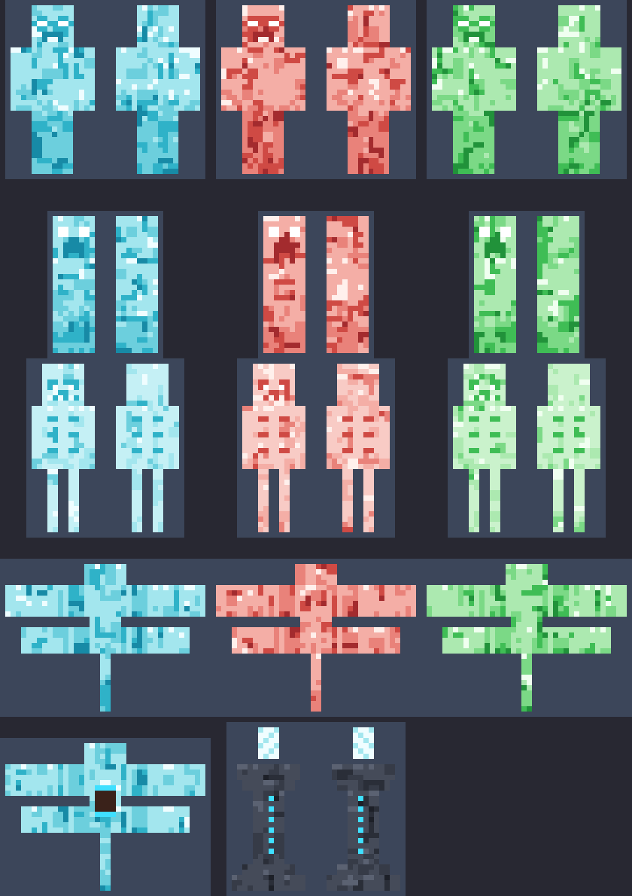
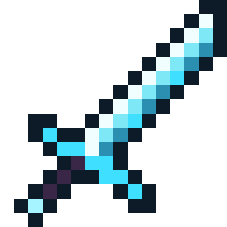

# Addons de mobs para Minecraft Bedrock

| Addon | Descarga | Generador |
|---|---|---|
| **Soul Corrupted** – mobs de alma corrupta + espada | [`dist/SoulCorrupted.mcaddon`](dist/SoulCorrupted.mcaddon) | `tools/soul_generate.py` |
| **Medieval Mobs** – mobs medievales | [`dist/MedievalMobs.mcaddon`](dist/MedievalMobs.mcaddon) | `tools/generate.py` |

Requieren Minecraft Bedrock **1.21.0 o superior** (Soul Corrupted: **1.21.90 o superior**). No hace falta activar experimentos.
Abre el `.mcaddon` y activa el pack *Behavior* en el mundo; el de recursos se añade solo.

---

# Soul Corrupted



Mobs corrompidos por almas, con texturas 16x16 de un azul celeste luminoso con vetas más oscuras.
Su modelo es igual al vanilla, sin piezas que sobresalgan. Hay 3 colores (azul, rojo y verde),
y cada color es un mob aparte con su propio huevo.

| Mob | IDs |
|---|---|
| Zombi de Alma Corrupta | `soul:corrupted_zombie_blue` / `_red` / `_green` |
| Creeper de Alma Corrupta | `soul:corrupted_creeper_blue` / `_red` / `_green` |
| Esqueleto de Alma Corrupta | `soul:corrupted_skeleton_blue` / `_red` / `_green` |
| Phantom de Alma Corrupta (4 alas, 2,5 veces más grande) | `soul:corrupted_phantom_blue` / `_red` / `_green` |
| Phantom de Alma Domable (azul, montable) | `soul:corrupted_phantom_mount` |
| Altar de Curación | `soul:healing_altar` |

**Comportamiento**

- **Oscuridad** (el efecto del Warden) en cada golpe, flecha o explosión.
- Extra según el color:
  - azul: lentitud.
  - rojo: prende fuego al objetivo, y su creeper deja fuego al explotar.
  - verde: veneno.
- **Ojos blancos brillantes** en todos.
- **Inmunes** a fuego, lava, bloques de magma, congelación, ahogamiento y wither. No se queman con el sol.
- Sueltan partículas de su color todo el tiempo.
- Las **explosiones del creeper** sueltan una nube de partículas de su color.
- El **phantom** se comporta como el vanilla, pero ataca mucho más seguido (cada 2-5 s) y vuela más bajo, más cerca de ti.

**Animaciones** (suavizadas)

- Al aparecer, en 1 segundo o menos:
  - el zombi y el esqueleto salen del suelo;
  - el creeper y el phantom crecen girando.
- El creeper se inclina hacia donde camina y hacia los giros.
- El zombi se tambalea.
- El esqueleto mira a su alrededor y sube el arco.
- El phantom bate sus 4 alas desfasadas y se inclina al girar y al subir o bajar.

**Dónde aparecen**

- De noche, en el Overworld.
- En el Nether, cada color en su bioma:
  - azul: valle de arena de almas;
  - rojo: bosque carmesí;
  - verde: bosque distorsionado.
- También con huevos en los generadores y con `/summon`.

### Phantom de Alma Domable

- No aparece de forma natural: solo con su huevo, desde el inventario creativo o con `/summon`.
- Es pacífico y vuela libremente, como un ghast.
- Se **domestica dándole huesos**, con un 33 % de probabilidad por hueso. Domesticado:
  - te sigue;
  - **se monta**: interactúa con él y dirígelo con el movimiento y la mirada, como un happy ghast;
  - se cura con huesos.
- Velocidad de vuelo 0,065, algo más rápido que el happy ghast (0,05). Es igual con o sin jinete.

### Altar de Curación

- Mide 2 bloques: un pedestal de pizarra profunda con runas de alma, un cuenco de fuego de alma y un cristal que flota y gira.
- Si estás a **10 bloques o menos**:
  - te apunta con un **rayo de partículas**;
  - te cura **1 de vida por segundo**, más rápido que la regeneración normal.
- **Receta** (mesa de crafteo):

  ```
  pizarra profunda labrada   farol de almas    pizarra profunda labrada
  pizarra profunda labrada   manzana dorada    pizarra profunda labrada
  pizarra profunda labrada   pizarra p. labr.  pizarra profunda labrada
  ```

- Se coloca como un huevo de generación.
- Solo los jugadores pueden romperlo, y al romperlo suelta el altar.

### Espada de Alma Corrupta (`soul:corrupted_soul_sword`)



- Textura 16x16. 9 de daño, más que la de netherita.
- Al golpear deja **Wither II** (5 s) y **quemadura** (5 s).
- **Daño en área**: los mobs a 3 bloques del objetivo reciben 5 de daño y Wither. No afecta a jugadores, mascotas, la montura ni el altar.
- **No se puede craftear.** Sale con un 2,5 % de probabilidad (más con Botín) al matar mobs de alma corrupta.
- Se encanta como una espada y se repara con fragmentos de eco.
- Lleva el tag `minecraft:is_sword`, el mismo que las espadas vanilla. Los paquetes de animación la tratan como una espada.

---

# Medieval Mobs

12 mobs **nuevos e independientes** (no reemplazan a los vanilla) inspirados en los
zombis, esqueletos, slimes, endermen y creepers, con aspecto medieval, modelos
propios y golpes que dejan **efectos negativos**.


## Los mobs

Cada mob tiene su propio identificador, su huevo de generación, sus reglas de spawn y su botín.
Los efectos de la columna "Al golpear" se aplican en cada golpe, flecha o explosión.

| Mob | ID | Qué hace | Al golpear |
|---|---|---|---|
| Caballero Zombi Caído | `medieval:zombie_knight` | Yelmo con visor y cresta, armadura completa, tabardo con cruz y espada de hierro. Resiste el empuje | Lentitud II, Debilidad |
| Zombi Lanzaflechas | `medieval:zombie_archer` | **Lanza flechas a puñetazos**, en ráfagas de dos con sus guanteletes gigantes. Lleva carcaj y gorro con pluma | Veneno, Hambre |
| Zombi de la Peste | `medieval:zombie_plague` | Médico de la peste: máscara de pico, sombrero, túnica larga e incensario | Náusea, Veneno, Hambre II |
| Esqueleto Espadachín | `medieval:skeleton_swordsman` | **Cuerpo a cuerpo** con espada, escudo en el brazo, gambesón y casco de hierro | Debilidad, Lentitud |
| Esqueleto Arquero Real | `medieval:skeleton_longbowman` | **A distancia** con arco y flechas de lentitud. Capucha verde y carcaj | Lentitud II, Debilidad |
| Señor de la Guerra Esqueleto | `medieval:skeleton_warlord` | **Combina las dos**: arco de lejos y espada al acercarte (cambia solo). Corona, capa y armadura negra. Es raro | Wither (cuerpo a cuerpo), Debilidad (flechas), Ceguera, Lentitud II |
| Slime del Pantano | `medieval:bog_slime` | **Mucho más rápido** que un slime normal. Musgo y setas encima. Se divide al morir | Veneno, Lentitud |
| Slime Real | `medieval:royal_slime` | **Rápido**, dorado, con corona y capa. Vive bajo tierra y se divide al morir | Debilidad, Fatiga minera, Náusea |
| Espectro del End | `medieval:ender_wraith` | Enderman encapuchado con túnica rasgada. Ataca a los jugadores cercanos aunque no lo mires | Ceguera, Wither |
| Caballero del End | `medieval:ender_knight` | Yelmo de obsidiana con cuernos, armadura, capa y espada. Neutral como el vanilla | Lentitud, Fatiga minera II, Levitación |
| Creeper de Asedio | `medieval:siege_creeper` | **Ataca y explota a la vez**: al golpearte enciende la mecha y sigue pegando mientras se hincha. Casco y barril de TNT. Explosión más fuerte | Lentitud, Debilidad |
| Creeper Pestilente | `medieval:plague_creeper` | **Ataca y explota a la vez**. Capucha, hongos y pústulas | Veneno, Náusea, Hambre II |

## Spawneo

- **Natural**: salen de noche o en la oscuridad, como los monstruos vanilla y junto a ellos.
  - El Slime del Pantano sale en pantanos y manglares.
  - El Slime Real sale bajo tierra, por debajo de Y=40.
  - Los endermen medievales también salen en el End.
- **Generadores (spawners)**: usa el huevo del mob sobre un generador de monstruos.
  Funciona igual que con los huevos vanilla.
- **Comandos**: `/summon medieval:skeleton_warlord`.
- **Huevos**: están en el inventario creativo, en la sección de huevos de generación.

## Estructura del proyecto

```
SoulCorrupted_BP/  SoulCorrupted_RP/   addon de alma corrupta
MedievalMobs_BP/   MedievalMobs_RP/    addon medieval
tools/             generadores en Python (modelos + texturas + JSON)
dist/              los .mcaddon listos para instalar
```

Los packs se generan con Python 3 y Pillow. Para cambiar vida, daño, efectos, colores o modelos:

1. Edita las tablas al principio del generador:
   - Soul Corrupted: `TYPES` y `COLORS` en `tools/soul_generate.py`.
   - Medieval Mobs: `MOBS` en `tools/generate.py`, y los modelos en `tools/models.py`.
2. Ejecuta el generador:

```
python3 tools/soul_generate.py --preview
python3 tools/generate.py --preview
```

Cada uno vuelve a generar sus packs y su `.mcaddon`. `--preview` además actualiza las imágenes de `docs/`.
