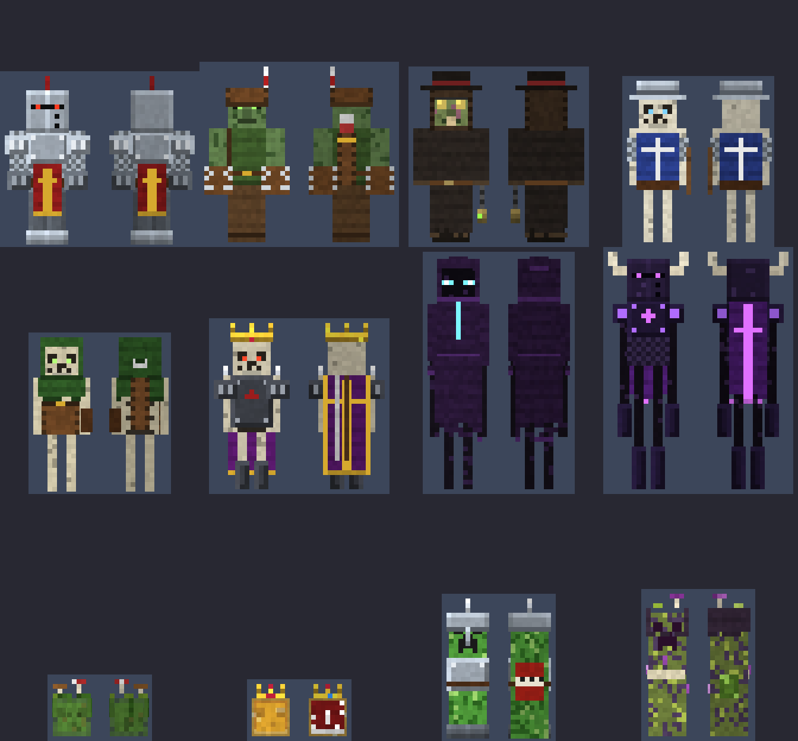

# Medieval Mobs – Addon para Minecraft Bedrock

12 mobs **nuevos e independientes** (no reemplazan a los vanilla) inspirados en los
zombis, esqueletos, slimes, endermen y creepers, con aspecto medieval, modelos
propios y golpes que dejan **efectos negativos**.



## Instalación

1. Descarga [`dist/MedievalMobs.mcaddon`](dist/MedievalMobs.mcaddon) y ábrelo: Minecraft importa los dos packs.
2. En el mundo, activa **Medieval Mobs (Behavior)**. El pack de recursos se añade solo.
3. Requiere Minecraft Bedrock **1.21.0 o superior**. No hace falta activar ningún experimento.

## Los mobs

Cada mob tiene su propio identificador, su huevo de generación, sus reglas de spawn y su botín.
Los efectos de la columna "Al golpear" se aplican en cada golpe, flecha o explosión.

| Mob | ID | Qué hace | Al golpear |
|---|---|---|---|
| Caballero Zombi Caído | `medieval:zombie_knight` | Yelmo con visor y cresta, armadura completa, tabardo con cruz y espada de hierro. Resiste el empuje | Lentitud II, Debilidad |
| Zombi Lanzaflechas | `medieval:zombie_archer` | **Lanza flechas a puñetazos**, en ráfagas de dos con sus guanteletes gigantes. Lleva carcaj y gorro con pluma | Veneno, Hambre |
| Zombi de la Peste | `medieval:zombie_plague` | Médico de la peste: máscara de pico, sombrero, túnica larga e incensario | Náusea, Veneno, Hambre II |
| Esqueleto Espadachín | `medieval:skeleton_swordsman` | **Cuerpo a cuerpo** con espada, escudo en el brazo, gambesón y casco de hierro | Debilidad, Lentitud |
| Esqueleto Arquero Real | `medieval:skeleton_longbowman` | **A distancia** con arco y flechas de lentitud. Capucha verde y carcaj | Lentitud II, Debilidad |
| Señor de la Guerra Esqueleto | `medieval:skeleton_warlord` | **Combina las dos**: arco de lejos y espada al acercarte (cambia solo). Corona, capa y armadura negra. Es raro | Wither (cuerpo a cuerpo), Debilidad (flechas), Ceguera, Lentitud II |
| Slime del Pantano | `medieval:bog_slime` | **Mucho más rápido** que un slime normal. Musgo y setas encima. Se divide al morir | Veneno, Lentitud |
| Slime Real | `medieval:royal_slime` | **Rápido**, dorado, con corona y capa. Vive bajo tierra y se divide al morir | Debilidad, Fatiga minera, Náusea |
| Espectro del End | `medieval:ender_wraith` | Enderman encapuchado con túnica rasgada. Ataca a los jugadores cercanos aunque no lo mires | Ceguera, Wither |
| Caballero del End | `medieval:ender_knight` | Yelmo de obsidiana con cuernos, armadura, capa y espada. Neutral como el vanilla | Lentitud, Fatiga minera II, Levitación |
| Creeper de Asedio | `medieval:siege_creeper` | **Ataca y explota a la vez**: al golpearte enciende la mecha y sigue pegando mientras se hincha. Casco y barril de TNT. Explosión más fuerte | Lentitud, Debilidad |
| Creeper Pestilente | `medieval:plague_creeper` | **Ataca y explota a la vez**. Capucha, hongos y pústulas | Veneno, Náusea, Hambre II |

## Spawneo

- **Natural**: salen de noche o en la oscuridad, como los monstruos vanilla y junto a ellos.
  - El Slime del Pantano sale en pantanos y manglares.
  - El Slime Real sale bajo tierra, por debajo de Y=40.
  - Los endermen medievales también salen en el End.
- **Generadores (spawners)**: usa el huevo del mob sobre un generador de monstruos.
  Funciona igual que con los huevos vanilla.
- **Comandos**: `/summon medieval:skeleton_warlord`.
- **Huevos**: están en el inventario creativo, en la sección de huevos de generación.

## Estructura del proyecto

```
MedievalMobs_BP/   behavior pack: entidades, spawn rules, loot tables, script
MedievalMobs_RP/   resource pack: modelos, texturas, animaciones, nombres
tools/             generador en Python (modelos + texturas pixel-art + JSON)
dist/              MedievalMobs.mcaddon listo para instalar
```

Todo el contenido de los packs se genera con `tools/generate.py`, que necesita Python 3 y Pillow.
Para cambiar vida, daño, efectos, colores o modelos:

1. Edita la tabla `MOBS` en `tools/generate.py`, o el modelo del mob en `tools/models.py`.
2. Ejecuta:

```
python3 tools/generate.py --preview
```

Esto vuelve a generar los packs y el `.mcaddon`. `--preview` además crea `docs/preview.png`.
