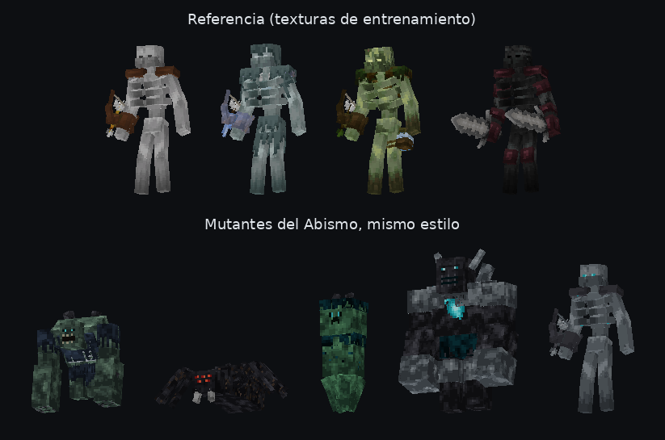

# Guía de estilo: mobs mutantes

Estilo aprendido de las texturas de entrenamiento del usuario (esqueleto, stray, bogged y esqueleto wither
mutantes, en `sources/mutant_references/`). **Todos los mobs nuevos deben seguirlo.** El código que lo aplica está
en `tools/mutant_style.py`; los mutantes del Abismo (`tools/abismo_mobs.py`) son el ejemplo de uso.



## Lienzo y UV
- Lienzo de **128×128** (256 de alto si no cabe), **1 texel por píxel del modelo** (cabeza 8×8×8, brazos 4×14×4…).
  La mayor parte de la hoja queda vacía.
- **UV de caja** (box UV). Las piezas repetidas (costillas, huesos de brazos y piernas) **comparten** la misma
  zona de la textura, y los lados izquierdo y derecho se reflejan con `mirror`.
- Planos sin grosor (`size` con un 0) para detalles: hongos, lianas, flecos y matojos.

## Color y sombreado
- Cada material es una **rampa de 6 a 8 tonos de un solo color** (sin contornos negros). Rampas en `RAMPS`.
- Sombreado **"nublado"**: manchas suaves de 2–4 texels, poco contraste y algo de grano. No hay ruido píxel a píxel
  ni degradados limpios.
- **Luz desde arriba**: las caras de arriba son más claras, las de abajo más oscuras y la de atrás algo más oscura
  que la de delante.
- Las caras largas (piernas, brazos) se **oscurecen hacia abajo** con **vetas verticales**.

## Detalles
- **Ojos**: ranuras de 2×1. Oscuras en mobs normales; brillantes (amarillo verdoso en el bogged, cian sculk en el
  Abismo) en mobs mágicos.
- **Boca**: una fila oscura con dientes claros sueltos; la mandíbula es un cubo aparte que se puede animar.
- **Capas encima** (ropa, musgo, sculk): cubos inflados (`inflate` 0.25–0.5) del mismo tamaño que la pieza, con el
  **borde de abajo deshilachado**: flecos que cuelgan a distintas alturas y huecos transparentes.
- **Grietas**: líneas de 1 texel uno o dos tonos más oscuras. **Venas de sculk**: caminos cortos de cian.
- Las **armas y objetos** van como cubos en un hueso de la mano (arco, espadas), con la madera en marrón y las
  cuerdas como cubos finos con `inflate` negativo.

## Modelos
- Siluetas de "mutante": torso alto y encorvado, extremidades largas, columna con costillas sueltas, cabeza pequeña
  con mandíbula.
- Huesos con nombres claros (`body`, `head`, `jaw`, `rightarm`/`rightarm2`, `leftleg`…) para poder animar.
- Material `entity_alphatest` para que las transparencias de los flecos funcionen.

## Cómo crear un mob nuevo en este estilo
```python
from mutant_style import Mat, Model, eyes, mouth, cracks, veins
m = Model("geometry.ns.nombre")
piel = Mat("rot_skin", streaks=0.45)                    # una rampa + vetas abajo
trapo = Mat("rag", fringe=4)                            # capa con flecos
cara = Mat("rot_skin").with_deco(front=[eyes(3, [1, 5], "#071a1c", core="#5ff2f2"), mouth(6, 1, 7)])
...
textura = m.build(seed=1); geometria = m.geometry()
```
`mutant_style.render()` dibuja el modelo con su textura para revisarlo antes de meterlo en el juego.
